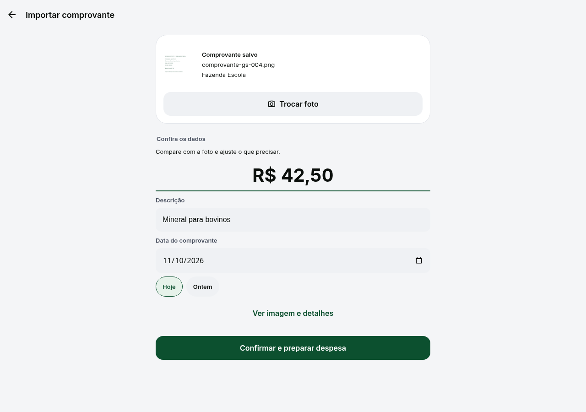

<p align="center">
  <picture>
    <source media="(prefers-color-scheme: dark)" srcset="agrogest-app/apps/mobile/assets/branding/v2/logo-dark-v2.png">
    
  </picture>
</p>

<p align="center">
  <strong>Do comprovante à decisão no campo.</strong><br>
  FIAP · Global Solution 2026 · CitizenTech: Tecnologia a Serviço do Cidadão
</p>

<p align="center">
  <a href="#proposta">Proposta</a> ·
  <a href="#como-funciona">Como funciona</a> ·
  <a href="#tecnologia-a-serviço-do-cidadão">Global Solution</a> ·
  <a href="#rodar">Experimentar</a>
</p>

# AgroGest

Um aplicativo para produtores e equipes rurais registrarem despesas, acompanharem o rebanho e entenderem os custos de cada lote. Capturas e registros ficam no aparelho para continuar o trabalho quando a conexão falha.

## Proposta

Transcrever comprovantes e reunir informações espalhadas em papéis e planilhas toma tempo e dificulta saber quanto custa manter o rebanho. O AgroGest reúne o registro da despesa, a conferência entre responsáveis e os indicadores da operação.

A proposta para a Global Solution é aplicar tecnologia à rotina de quem vive e trabalha no campo, com foco em **agricultura inteligente e desenvolvimento rural**. O objetivo é diminuir o retrabalho e oferecer informações mais claras para decidir.

## Como funciona

1. **Escolha o comprovante.** Envie uma foto da despesa.
2. **Confira a leitura.** A IA sugere valor, data e descrição; você corrige o que precisar.
3. **Prepare a despesa.** Defina a categoria e os lotes que recebem o custo.
4. **Envie para aprovação.** O registro segue as permissões da operação.
5. **Acompanhe o resultado.** A despesa aprovada atualiza os indicadores de custo do rebanho.

A imagem original acompanha o lançamento. Registros feitos sem conexão ficam guardados e são sincronizados depois; a leitura da imagem precisa do serviço de análise disponível.

<p align="center">
  
</p>
<p align="center"><em>Demonstração com recibo sintético. A extração processa a imagem; os campos continuam sujeitos à revisão.</em></p>

## Para quem

- **Produtores:** acompanham custos por lote e organizam os compromissos da fazenda.
- **Equipes do campo:** registram a rotina e preservam as informações até poder sincronizar.
- **Sócios e responsáveis:** conferem os comprovantes, aprovam despesas e acompanham o histórico.

O impacto esperado é reduzir o esforço de registro e melhorar a informação disponível para a gestão. Esses benefícios ainda precisam ser medidos em um piloto com produtores.

## Tecnologia a serviço do cidadão

| Tecnologia da GS | Aplicação no AgroGest |
| --- | --- |
| Visão computacional | Leitura das imagens dos comprovantes. |
| Inteligência artificial | Sugestão dos campos da despesa, com revisão humana. |
| Análise de dados | Cálculo de custos acumulados, custo por cabeça e indicadores por lote. |
| Computação em nuvem | Serviços e dados preparados para Cloudflare. A versão validada roda localmente; a validação em nuvem permanece uma etapa futura. |

A contribuição proposta ao **ODS 2, meta 2.3**, é apoiar o acesso de produtores à informação útil para gerir a atividade. Aumento de renda ou produtividade são resultados a investigar, sem medição de impacto em campo até aqui.

## Rodar

Com Node 24 e Docker local, execute na raiz:

```sh
npm run setup:local
npm run build:web
npm start
```

Abra **http://127.0.0.1:8787/entrar**. As [contas de demonstração e o roteiro de teste](agrogest-app/docs/CLOUDFLARE_LOCAL.md#contas-sintéticas) estão no guia de execução. A [opção de IA visual local](agrogest-app/docs/CLOUDFLARE_LOCAL.md#ia-visual-local-opcional) prepara o modelo para ler a foto e sugerir os campos em uma única etapa.

## Saiba mais

[Requisitos da Global Solution](agrogest-app/docs/gs/REQUISITOS_GS.md) · [Documentação do projeto](agrogest-app/docs/README.md) · [Evidências de validação](agrogest-app/docs/HISTORICO_REVISOES.md)
