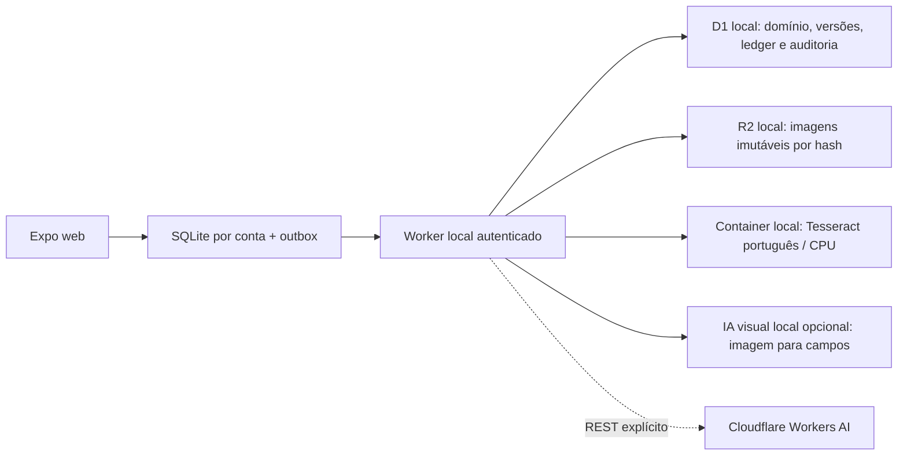

# Backend e execução locais da versão acadêmica

Conferência funcional inicial: **06/11/2026**. OCR em container local acrescentado em **09/11/2026** e IA visual local em **10/11/2026**; evidências por execução no [histórico](HISTORICO_REVISOES.md). Esta referência substitui a configuração Supabase nesta versão. As migrations PostgreSQL e os documentos de outubro continuam como histórico e regressões; nenhum serviço remoto da aplicação foi usado nesta adaptação.

## Primeira execução

Na raiz do clone, use **Node 24.10+ da linha 24** e npm. Escolha onde a imagem será analisada; o aplicativo, o D1 e o R2 de desenvolvimento continuam no computador em todos os modos.

| Cenário | Pré-requisitos adicionais | Modelo e execução |
| --- | --- | --- |
| `local` · padrão | Docker local com Compose v2+ e containers Linux | Tesseract português, CPU, em container local; parser determinístico |
| `local-vision` | Linux x86_64, Python 3.12+ e CUDA compatível para o launcher fornecido | Qwen3-VL-2B-Instruct Q4_K_M em llama.cpp; imagem → campos na máquina do backend |
| `workers-ai` | Conta Cloudflare com Workers AI e token restrito | Llama 4 Scout na Cloudflare; REST chamado pelo backend local. Dispensa Docker, Python e GPU própria |

O OpenRouter foi removido dos adaptadores e da configuração vigente por decisão do usuário em 10/11. Estudos e autorizações antigos permanecem somente no arquivo/histórico. Não há seleção automática de outro provedor.

```sh
# Padrão CPU, sem conta de IA e sem GPU:
npm run setup:local
npm run doctor
npm run build:web
npm start
```

`setup:local` instala pelos três lockfiles e prepara apenas o provedor selecionado. Sem configuração existente, cria `.dev.vars` para `local` e constrói o OCR no daemon Docker **local**. Com uma seleção anterior, preserva-a. Para escolher outro modo já na instalação:

```sh
# App e dados locais; somente a análise da imagem usa a Cloudflare:
npm run setup:local -- --provider workers-ai
# Edite WORKERS_AI_ACCOUNT_ID e WORKERS_AI_API_TOKEN no arquivo privado indicado abaixo.
npm run doctor
npm run build:web
npm start
```

`doctor` informa dependências/configurações ausentes sem mostrar valores secretos e sem inferência. Uma credencial ausente não impede abrir o aplicativo; a leitura apresenta erro de configuração e a captura permanece guardada. Isso não conta como teste de IA remota.

`npm start` constrói o frontend se faltar, aplica **somente migrations locais** e inicia Worker + frontend em **http://127.0.0.1:8787**. Inicia o container apenas em `local` e o servidor visual apenas em `local-vision`. Workers AI não inicia nenhum dos dois. D1/R2 são emulados pelo workerd/Miniflare. `AGROGEST_PORT` permite outra porta loopback de 1024 a 65535, inclusive para validar clones isolados. O modo visual também aceita servidor local compatível já iniciado na URL configurada; o launcher automático continua limitado à plataforma documentada.

Downloads de pacotes/pesos são preparação, não inferência hospedada. Com dependências e modelo/imagem preparados, a inicialização reutiliza o cache. O caminho CPU dispensa Python/Tesseract no host: a imagem contém Python 3.14, Tesseract **5.3.0-2** do Debian Bookworm e modelo português verificado. A base é fixada por digest; pacotes transitivos do apt não constituem snapshot completo do Debian. Windows/macOS com Docker são caminhos previstos, ainda sem validação nesta entrega; não declarar suporte comprovado com base no teste Linux.

Use sempre a mesma origem para manter sessão e SQLite; `localhost` e `127.0.0.1` são origens distintas no navegador. Não remova `.local/`, dados do site ou bancos para resolver erro de abertura. Um bloqueio transitório de OPFS recebe repetição limitada; erro persistente apresenta **Tentar novamente**, preservando registros. Use uma aba por conta/origem; abas simultâneas no mesmo perfil podem disputar o pool OPFS do Expo.

### Trocar a inferência sem trocar o banco

```sh
npm run configure -- --provider local
npm run configure -- --provider local-vision
npm run configure -- --provider workers-ai
```

Execute **uma** seleção e reinicie `npm start`. O comando altera somente a configuração privada do provedor, preserva as demais credenciais, os bancos e a outbox; a chave visual existente permanece disponível ao voltar para o modo local. `local-vision` exige seu setup abaixo; Workers AI exige conta/token privados. A configuração antiga do provedor removido é descartada. Nenhum desses comandos publica o app ou chama um modelo. A troca de modelo/provedor invalida o cache de sugestões, sem reescrever despesas já aprovadas.

### Ciclo do container OCR

```sh
npm run ocr:build  # constrói localmente, sem enviar imagem a registry
npm run ocr:local  # inicia só o OCR e aguarda /health
npm run ocr:stop   # encerra o projeto Compose agrogest-local
npm run test:ocr   # guarda contra daemon remoto + testes de OCR sem rede no container
```

`npm start` encerra o container que iniciou ao receber Ctrl+C. Se o OCR já estava iniciado com `ocr:local`, ele permanece disponível e pode ser encerrado com `ocr:stop`. Encerrar/recriar o OCR não remove D1/R2, SQLite ou outbox: nenhum dado do aplicativo é montado no container. A imagem é reconstruída quando o código muda; não há bind mount do workspace.

O Compose em `agrogest-app/compose.local.yaml` publica **somente `127.0.0.1:8091`**. O processo escuta `0.0.0.0` dentro do container para receber esse encaminhamento. Executa com UID/GID 10001, raiz somente leitura, `/tmp` efêmero de 64 MiB, limite de 2 CPUs, 1 GiB e 64 processos, sem capabilities ou dispositivos GPU. Esses limites são configuração de desenvolvimento, não benchmark de capacidade. O runtime usa bridge Docker e não faz chamadas externas; isso não é uma regra de firewall de saída. Os testes Python rodam com `network_mode: none`, usando apenas os pesos incluídos.

Os scripts recusam contextos/hosts Docker SSH/TCP, usam builder local e não possuem comando de push/deploy. `.dockerignore` permite apenas fonte OCR e dois recibos sintéticos de teste; segredos, bancos, `.local`, `.git` e dependências ficam fora do contexto. `/health` confere checksum do modelo e presença do executável. `/extract` continua exclusivo do backend, com rejeição de `Origin`, limite de 8 MiB, uma extração por vez e timeout de 35 segundos. Não expor esse serviço sem autenticação/TLS numa hospedagem futura.

O modo nativo anterior continua opcional para diagnóstico: instale Python 3.10+ e Tesseract 5, execute `npm run setup:ocr:native`, `npm run ocr:native` e `npm run api:local` em terminais separados. Não execute OCR nativo e container na mesma porta. O backend mantém o mesmo contrato HTTP; não há fallback silencioso entre eles.

Para editar com Metro, mantenha OCR/API locais e execute `npm run web` em outro terminal. O build também copia o WASM do player dotLottie e sua licença MIT do pacote fixado para `public/`, evitando o download padrão da biblioteca em CDN. O frontend Metro usa `http://localhost:8081`; o Worker autoriza essa origem e `127.0.0.1:8081`. Após recompilar o SPA, reinicie o Worker para atualizar o manifesto dos assets. `npm run build:web` acrescenta o service worker; `expo export` isoladamente não o acrescenta.

### Contas sintéticas

| Conta | E-mail | Vínculo |
| --- | --- | --- |
| Ana | `ana@agrogest.local` | Sócia da Fazenda Escola |
| Bruno | `bruno@agrogest.local` | Outro sócio; aprova a despesa de Ana |
| Camila | `campo@agrogest.local` | Funcionária; sem financeiro geral nem aprovação financeira |
| Diego | `isolado@agrogest.local` | Sócio de outra operação isolada |

Senha pública **exclusivamente de demonstração local**: `AgroGest2026!`. O servidor confere PBKDF2-SHA256, emite token aleatório, armazena somente hash de token no D1 e verifica sessão em cada requisição. Isso não é login por e-mail livre. Não há cadastro, envio de e-mail, confirmação por link nem recuperação operacional nesta versão; a interface informa essa limitação. As identidades de demonstração são pré-confirmadas. A preparação de nuvem omite essa carga e recusa essas identidades/senha no ambiente hospedado. O bootstrap privado abaixo permite contas administradas para um piloto; cadastro/recuperação e proteção contra abuso em produção continuam pendentes.

A carga inicial tem dados sintéticos: 10 novilhos, compra de R$ 10.000,00, peso de 300 kg e aluguel de pastagem zero. Migrations usam `INSERT OR IGNORE`, sem limpar dados já gravados.

## Roteiro demonstrável

1. Entre como Ana, abra **Despesa → Escolher comprovante**. O seletor abre diretamente; após escolher, a captura é salva e a revisão inicia a leitura automaticamente. A antiga rota Nota fiscal também encaminha para esse importador real.
2. Escolha uma foto PNG/JPEG/WebP de até 8 MiB. Exemplos sintéticos reproduzíveis estão em `agrogest-app/tests/fixtures/comprovante-gs-001.png` e `comprovante-gs-002.png`. São imagens de teste, não notas fiscais autênticas.
3. A captura é salva no SQLite da conta **antes** do upload. O Worker guarda bytes no R2 local e metadata/hash no D1. O OCR recebe os bytes efetivos e retorna texto, palavras, caixas/confiança e campos; nada usa a antiga amostra constante.
4. Confira valor, data, fornecedor, descrição e número contra a imagem. Campo ausente permanece vazio; não há substituição silenciosa por resultado inventado. Confirme a revisão e prepare a despesa.
5. Escolha **categoria**, confira fazenda, parcelas e **rateio**. O importador não escolhe essas regras pelo usuário. Envie; com Ana e Bruno na operação, o status recebido é **Aguardando aprovação**.
6. Entre como Bruno em outro perfil/contexto do navegador ou saia de Ana e entre como Bruno. Abra o lançamento, confira **Ver comprovante original** e aprove. O autor e a funcionária não podem aprovar essa despesa financeira.
7. Abra o lote e veja custo acumulado, custo por cabeça e ponto de equilíbrio. Com apenas o comprovante GS-001 aprovado: **R$ 11.250,40**, **R$ 1.125,04/cabeça** e estimativa **R$ 112,50/@**. Antes da aprovação, a despesa não entra no custo confirmado. O indicador é calculado pelas funções originais do domínio; não é número fixo de tela.
8. Para demonstrar offline: extraia GS-002, conclua a revisão, desconecte a rede do navegador e envie. Reabra o aplicativo: a intenção fica **aguardando envio**, no SQLite/outbox. Reconecte, sincronize e somente depois aprove com Bruno. Fotografar offline também preserva a captura para analisar mais tarde; OCR/backend exigem conexão local disponível.

O documento é único por operação/hash e só pode estar vinculado a uma despesa. Repetir o mesmo comando retorna a confirmação anterior; reutilizar o ID com dados diferentes é recusado. A captura pode ser reaberta sem novo OCR. O anexo é acessível ao autor e a sócios autorizados; não há URL pública do R2.

## Contrato e armazenamento



| Fronteira | Implementação |
| --- | --- |
| Leitura | `POST /api/rpc/agrogest_workspace`: projeção por vínculos e cargo; funcionário não recebe coleções financeiras e custos de compra |
| Escrita | `POST /api/rpc/agrogest_command`: catálogo de 38 ações, ID do comando, payload, controle de versão e validações do domínio |
| Sessão | `/api/auth/login`, `/api/auth/user`, `/api/auth/logout`; sete dias de validade, verificação no servidor |
| Documentos | `POST /api/documents?operationId=…`, `GET /api/documents/:id`, `/content`, `POST …/extract` |
| Saúde | `GET /api/health`: distingue infraestrutura local e provedor de inferência |
| Persistência do servidor | `agrogest-app/.local/cloudflare/`, ignorada no Git; não apagar durante reinicializações |
| Persistência do cliente | SQLite v15 por backend/conta; o backend padrão preserva `agrogest-worker-local-<conta>.db`. Trocar a inferência não troca o banco. `local_documents` fica fora dos snapshots e a outbox é preservada |
| Migrations D1 | `0001_domain.sql`, `0002_local_demo.sql`, `0003_inference_usage.sql`, somente `--local` |

O arquivo `services/supabase.ts` é uma fachada compatível para as chamadas existentes da outbox, delegando ao cliente HTTP próprio. **Não importa SDK Supabase**. A dependência foi removida. Nomes RPC foram mantidos para reduzir risco de reescrever UI/regras ao mesmo tempo. `database.types.ts` ainda serve como tipo JSON histórico; não ativa conexão.

A gravação usa snapshot + revisão global e **batch D1 atômico**. O primeiro statement insere uma guarda com `CHECK(ok=1)` somente se revisão e sessão ainda forem válidas; falha aborta domínio, ledger, vínculo documental e auditoria juntos. Corridas repetem a leitura, revalidam e rejeitam revisão obsoleta. Não há uma sequência de writes soltos após um `UPDATE` que possa afetar zero linhas. A revisão global simplifica correção; não é uma solução de escala demonstrada.

`discard_entry` `{ id, operationId }`: só o autor (403 caso contrário) exclui, em rascunho, rejeitado, conflito ou aguardando aprovação; aprovado é recusado com 409 e o vínculo `document_entry_links` do comprovante é removido na mesma transação.

O ledger tem chave `(ator, comando)` e payload canônico. Aprovação não altera a autoria; servidor determina status/histórico/revisão. Baixa altera caixa, não custo. Transferência mantém origem econômica e custo transportado. Membros removidos/permissões reduzidas são reavaliados inclusive no replay. Snapshot só substitui o cache sem comandos pendentes.

## Inferência e credenciais transferíveis

O padrão distribuído é **`INFERENCE_PROVIDER=local`**; a opção `local-vision` foi validada em 10/11 e está configurada neste ambiente de desenvolvimento. O Tesseract 5 executa reconhecimento neural/CV, com `por.traineddata` do `tessdata_fast`, revisão `87416418657359cb625c412a48b6e1d6d41c29bd`, Apache-2.0, SHA-256 `c4932b937207a9514b7514d518b931a99938c02a28a5a5a553f8599ed58b7deb`. O parser de valor/data é determinístico; ele não é apresentado como um segundo modelo de IA. Três recibos sintéticos legíveis foram processados nas validações datadas, com correção humana do número no terceiro; isso não mede acurácia em fotos rurais difíceis, DANFE, manuscritos ou PDFs.

Para configuração privada, copie **`agrogest-app/apps/api/.dev.vars.example` → `.dev.vars`**, edite no próprio arquivo e reinicie o Worker. Esse é o exemplo consumível pelo Wrangler. `agrogest-app/docs/arquivo/inference.env.example` permanece referência histórica e aponta para ele. Nunca cole chave num comando, screenshot, commit, frontend ou log.

| Seleção | Variáveis do backend e comportamento |
| --- | --- |
| Local | `INFERENCE_PROVIDER=local`, `LOCAL_OCR_BASE_URL=http://127.0.0.1:8091`; sem token nem internet de inferência |
| IA visual local | `INFERENCE_PROVIDER=local-vision`, `LOCAL_VISION_BASE_URL`, `LOCAL_VISION_MODEL`, `LOCAL_VISION_REVISION`, `LOCAL_VISION_API_KEY`; imagem direta para JSON, sem Tesseract intermediário nem permissão de inferência remota |
| Workers AI local → cloud | `INFERENCE_PROVIDER=workers-ai`, `INFERENCE_REMOTE_ALLOWED=true`, `WORKERS_AI_TRANSPORT=rest`, `WORKERS_AI_ACCOUNT_ID`, `WORKERS_AI_API_TOKEN`, `WORKERS_AI_MODEL=@cf/meta/llama-4-scout-17b-16e-instruct`; HTTPS pelo backend, sem binding AI no Wrangler local |
| Workers AI hospedado · futuro | `WORKERS_AI_TRANSPORT=binding` usa `env.AI.run` na conta de hospedagem, sem token de inferência; `rest` permite conta de IA separada com token como secret do Worker |

O adaptador Workers AI tem contratos REST/binding verificados por testes simulados, **sem chamada real ao provedor nesta revisão**: credenciais/modelo de conta não foram fornecidos no ambiente de execução. Há limite de 20 solicitações remotas por conta do app/dia (reserva atômica no D1, incluindo falhas depois de iniciar a tentativa), timeout e limite de saída; configuração ausente é recusada antes de consumir a cota; falhas não disparam outro provedor. O limite de solicitações **não é teto monetário**. Defina orçamento/chave restrita no provedor antes do primeiro teste pequeno. Capacidade do modelo, formato e política do endpoint precisam ser confirmados no teste real. Erros do provedor não são registrados com headers/conteúdo secreto.

A conta que paga IA é independente das identidades do aplicativo e da futura hospedagem. Quem publicar recebe código, exemplos vazios e instruções de exportação/restauração; fornece suas próprias chaves e repete os testes. As credenciais temporárias do usuário não são transferidas. O código é compartilhado pelo [repositório público](https://github.com/badmuriss/agrogest).

Referências de contrato: [Cloudflare REST](https://developers.cloudflare.com/workers-ai/get-started/rest-api/), [Scout](https://developers.cloudflare.com/workers-ai/models/llama-4-scout-17b-16e-instruct/), [modelo português e licença](https://github.com/tesseract-ocr/tessdata_fast/tree/87416418657359cb625c412a48b6e1d6d41c29bd). A pesquisa histórica de modelos Hugging Face, recursos e licenças está no [plano](gs/PLANO.md); a seleção vigente está neste guia; nenhum Space/Endpoint hospedado foi usado.

### Neurons incluídos no Workers AI

Conferido em **10/11/2026** na [tabela oficial](https://developers.cloudflare.com/workers-ai/platform/pricing/): o **Llama 4 Scout** configurado participa da franquia de **10.000 Neurons/dia por conta**, compartilhada com outros usos de Workers AI. O reset é às 00:00 UTC. No Free, esgotar a cota bloqueia chamadas; no Paid, excedentes custam US$ 0,011 por 1.000 Neurons.

O consumo varia com a imagem/contexto e a saída; não há quantidade garantida de fotos. Monitore o painel Workers AI. A cota de 20 tentativas por usuário/dia do app é independente. Workers, D1 e R2 têm condições próprias; a franquia de IA não significa hospedagem inteira ilimitada ou gratuita.

### IA visual local opcional

Esta opção usa **Qwen3-VL-2B-Instruct**, Apache-2.0, em `llama.cpp` (MIT), para ler a imagem e sugerir os campos em uma única chamada. O manifesto `services/extraction/vision-model.json` fixa revisão, arquivos públicos, quantização Q4_K_M do modelo, projetor Q8 e SHA-256; pesos e runtime ficam em `.local/vision/`, fora do Git e do frontend. Não é um serviço hospedado do Hugging Face.

O launcher fornecido foi validado em **Linux x86_64, Python 3.14 e RTX 4070 SUPER de 12 GiB**, com cerca de 3 GiB alocados pelo processo na GPU. Requer Python 3.12+; não foi validado em Windows/macOS/ARM. Drivers CUDA compatíveis são necessários para GPU. O modo CPU é uma seleção explícita por `AGROGEST_VISION_GPU_LAYERS=0`, sem medição de latência equivalente. O caminho Tesseract em Docker continua disponível como alternativa e segue sem exigir GPU.

```sh
# Na raiz; instala dependências e prepara o modelo com hashes verificados.
npm run setup:local -- --provider local-vision
# Em instalação já existente, basta npm run setup:vision.
npm start

# Para iniciar somente o modelo local, opcionalmente em outro terminal:
npm run vision:local
```

O setup cria uma chave local aleatória em `.local/vision/api-key`, com acesso restrito, e atualiza **somente as chaves deste provedor** em `apps/api/.dev.vars`, preservando o restante da configuração privada. `npm start` aguarda a saúde do servidor em `127.0.0.1:8092`, inicia-o se necessário e encerra o processo que iniciou junto com o app. Um modelo já iniciado em outro terminal é reutilizado e permanece sob responsabilidade daquele terminal. Não há download durante a inferência nem fallback automático para um provedor remoto. O launcher verifica CUDA antes do uso GPU; a chave é enviada pelo backend, nunca pelo navegador. Quem usar o modelo executa o setup na própria máquina para gerar sua configuração.

Campos ausentes continuam nulos. Datas brasileiras explícitas são normalizadas para ISO no backend e validadas pelo calendário; dinheiro precisa ser centavos inteiros. A revisão mostra primeiro valor, descrição e data, com imagem ampliada, fornecedor e número em **Ver imagem e detalhes**. A revisão humana e a política de aprovação continuam obrigatórias. O cache documental inclui versão do pipeline e do modelo: extrações antigas são substituídas ao analisar novamente, sem alterar os lançamentos aprovados. **Refazer leitura** reprocessa o mesmo arquivo e substitui as sugestões da revisão; correções manuais permanecem nas reaberturas comuns.

O Tesseract também recebeu correção do parser TSV: aspas reconhecidas são literais, não delimitadores de CSV. A tabela interna não deve aparecer como texto reconhecido. O parser conservador aceita total com ponto decimal, ignora totais de tributos e deixa datas conflitantes em branco.

Referências: [modelo e licença](https://huggingface.co/Qwen/Qwen3-VL-2B-Instruct-GGUF), [entrada multimodal local](https://github.com/ggml-org/llama.cpp/blob/master/docs/multimodal.md) e [API local e schema](https://github.com/ggml-org/llama.cpp/blob/master/tools/server/README.md). As medições desta máquina e os limites da validação ficam no [histórico](HISTORICO_REVISOES.md), separados de qualquer expectativa de desempenho em produção.

## Preparar a futura hospedagem Cloudflare

**Implementado para preparação e teste local; publicação ainda não realizada.** O caminho previsto reúne SPA e API no mesmo Worker com Static Assets, D1, R2 privado e Workers AI. Não precisa hospedar um container ou alugar GPU para o OCR. O modelo local não roda dentro do Worker. `cloud:check` exporta o frontend para usar sua própria origem, gera configuração de teste com IDs sintéticos e executa apenas `wrangler deploy --dry-run`. Isso empacota o código; não testa a conta, a inferência nem um serviço hospedado. Como recompila `dist`, reinicie um `npm start` já aberto para atualizar o manifesto de assets.

```sh
# Na raiz; nenhum comando abaixo publica ou provisiona:
npm run cloud:check
npm run cloud:prepare -- --env staging
npm run cloud:bootstrap -- --env staging
```

A primeira preparação cria `agrogest-app/.local/cloud/staging/settings.json` a partir de `apps/api/cloud.example.json`. Preencha conta, nome do Worker, origem HTTPS `https://<worker>.<subdomínio-da-conta>.workers.dev`, nome/ID do D1 e bucket do **ambiente futuro**. Nesta fase, se os recursos ainda não existem, registre os campos pendentes; não invente IDs e não provisione apenas para completar o arquivo. Reexecute para gerar `wrangler.jsonc` privado e migrations. Custom domain precisa de uma configuração adicional de rota/DNS; não está automatizado. `production` usa outra pasta e exige Worker, banco e bucket distintos na mesma conta.

O pacote de nuvem copia as migrations de schema `0001_domain.sql` e cota `0003_inference_usage.sql`; **não copia `0002_local_demo.sql`**. As migrations locais originais continuam intactas. Gerar/copiar SQL não o aplica em banco algum. O bootstrap cria um modelo privado `accounts.json`; após preenchê-lo e repetir o comando, gera `bootstrap.sql` com hashes PBKDF2 e identidades próprias. Não grava senha em SQL nem cria contas no backend automaticamente. A aplicação futura é manual, em banco vazio ou administrado pelo responsável, após revisão. O bootstrap é idempotente, não redefine senha de conta existente e não é um fluxo de recuperação de senha. Depois do login, o responsável cria sua fazenda e convida outras contas pré-configuradas pela interface existente.

### Contas de inferência e passagem ao responsável pela hospedagem

- **Agora:** `.dev.vars` guarda somente no backend a conta/token de inferência do usuário. O token deve ter permissão Workers AI na conta selecionada; não precisa permissão de deploy/D1/R2. O app local envia a imagem inline por HTTPS, sem torná-la pública no R2.
- **Cloudflare na conta do responsável:** usar `inferenceTransport=binding` em `settings.json`. A inferência usa a conta que hospeda o Worker, sem copiar o token temporário. Contas do aplicativo continuam independentes das contas Cloudflare.
- **Hospedagem do responsável com inferência temporária do usuário:** selecionar `inferenceTransport=rest` e `inferenceAccountId` separado. Em fase autorizada de publicação, o titular configura `WORKERS_AI_API_TOKEN` como secret do Worker, fora do arquivo versionado. A substituição posterior exige somente configuração/secret e novo teste, sem alterar domínio ou dados.

Compartilhe clone, lockfiles, exemplos vazios e este guia. Não compartilhe `.dev.vars`, `.local`, pesos, bancos do navegador, tokens ou `accounts.json`. Revogue o token temporário quando ele deixar de ser usado. D1/R2 e políticas de backup/retensão pertencem à conta de hospedagem; defina responsável, orçamento e teste de restauração antes de dados reais. O limite diário da aplicação não limita todos os gastos da conta Cloudflare.

### Deploy com Wrangler na conta do responsável

Este roteiro é para quem vai publicar na própria conta. Preparação e deploy são etapas diferentes: os comandos de recurso/migration/deploy abaixo são **remotos** e devem ser executados pelo responsável quando decidir publicar. Não foram executados pelo agente nesta fase. A instalação local e a verificação `cloud:check` continuam independentes de publicação.

**1. Clonar e instalar.** Node 24.10+ da linha 24 e npm são suficientes para esse caminho. Docker, Python e GPU não são necessários. Na raiz:

```sh
git clone https://github.com/badmuriss/agrogest.git
cd agrogest
npm run setup:local -- --provider workers-ai
npm run cloud:prepare -- --env staging
npm run cloud:bootstrap -- --env staging
```

Os dois últimos comandos criam os modelos privados na primeira execução. O perfil local REST pode informar conta/token ausentes no `doctor`; para o deploy com **binding**, não é preciso preencher o token REST em `.dev.vars`.

**2. Autenticar e escolher a conta.** No diretório `agrogest-app/apps/api`:

```sh
npx --no-install wrangler login
npx --no-install wrangler whoami
```

No Dashboard da conta de hospedagem, habilite **Workers AI**, configure o subdomínio `workers.dev` e ative **R2**. R2 exige sua [assinatura no painel](https://developers.cloudflare.com/r2/get-started/), com franquia/condições próprias. Confirme o `accountId` mostrado pelo CLI e o subdomínio da conta; não use o token/conta temporários de outra pessoa. Se o shell já tiver `CLOUDFLARE_ACCOUNT_ID` ou tokens de outro projeto, ajuste/remova essas variáveis antes de continuar.

**3. Configurar a conta antes de criar recursos.** Edite `agrogest-app/.local/cloud/staging/settings.json`: preencha `accountId`, confirme os três nomes de recursos e mantenha `inferenceTransport` como `binding`. A origem deve ser `https://agrogest-staging.SEUSUBDOMINIO.workers.dev`, substituindo `SEUSUBDOMINIO` pelo real. `databaseId` ainda fica vazio. Na raiz:

```sh
npm run cloud:account -- --env staging
```

Isso gera `provision.jsonc` privado, apenas com a conta e sem bindings de desenvolvimento. A seguir, **em `agrogest-app/apps/api`**, crie os recursos na conta selecionada:

```sh
npx --no-install wrangler d1 create agrogest-staging --config ../../.local/cloud/staging/provision.jsonc --no-update-config
npx --no-install wrangler r2 bucket create agrogest-documents-staging --config ../../.local/cloud/staging/provision.jsonc --no-update-config
```

Esses nomes são os padrões do exemplo. Se já existirem, confirme que pertencem ao ambiente pretendido; não apague recursos para repetir o roteiro. Os comandos de criação não alteram o `wrangler.jsonc` local. Copie o UUID retornado pelo D1 para `databaseId` em `settings.json`; o bucket fica privado, sem URL pública e sem chave S3 no frontend.

**4. Preparar configuração e contas do aplicativo.** Em `accounts.json` privado, cadastre e-mails próprios e senhas de 12 a 128 caracteres. Para demonstrar aprovação entre sócios, prepare pelo menos duas contas; não use `@agrogest.local` ou a senha pública da demonstração. Na raiz:

```sh
npm run cloud:prepare -- --env staging
npm run cloud:bootstrap -- --env staging
npm run cloud:check
```

Revise `wrangler.jsonc`, `bootstrap.sql` e a pasta `migrations` gerados em `.local/cloud/staging/`. Devem existir somente as migrations `0001_domain.sql` e `0003_inference_usage.sql`; a carga local `0002_local_demo.sql` não entra. O bootstrap não redefine senhas existentes. Guarde as senhas num gerenciador próprio e remova o `accounts.json` depois de concluída a configuração.

**5. Conferir o pacote e publicar.** No diretório `agrogest-app/apps/api`:

```sh
npx --no-install wrangler deploy --dry-run --env staging --config ../../.local/cloud/staging/wrangler.jsonc
npx --no-install wrangler d1 migrations apply agrogest-staging --remote --env staging --config ../../.local/cloud/staging/wrangler.jsonc
npx --no-install wrangler d1 execute agrogest-staging --remote --env staging --config ../../.local/cloud/staging/wrangler.jsonc --file ../../.local/cloud/staging/bootstrap.sql
npx --no-install wrangler deploy --env staging --config ../../.local/cloud/staging/wrangler.jsonc
```

Use **o arquivo de staging**, não o `wrangler.jsonc` local da API. O `cloud:check` já exporta o frontend com a API na própria origem. O binding AI dispensa token de inferência; o login Wrangler autoriza a administração da conta. Para separar a conta de IA da hospedagem, use a opção REST descrita acima e configure o secret `WORKERS_AI_API_TOKEN` com `wrangler secret put` usando o mesmo `--env staging --config …`; nunca digite a chave no comando nem publique `.dev.vars`.

**6. Abrir e preparar a demonstração.** Use a URL exata de `settings.json`. `/api/health` deve indicar `environment: staging` e `inferenceProvider: workers-ai`. Entre com sua conta, crie fazenda/lote e convide a segunda conta como sócia; ambas precisam estar configuradas no bootstrap. Cadastre uma conta financeira se for registrar pagamento. As contas/dados públicos da demonstração local não aparecem na base nova.

**7. Promover quando apropriado.** Para produção, repita com `--env production`, pasta própria e Worker/D1/bucket distintos. Confirme Auth/recuperação, proteção contra abuso e backup/restauração adequados ao público antes de uso público com dados reais. Staging é o alvo do primeiro deploy e da apresentação controlada da GS. O código bloqueia identidades/senha públicas de demonstração fora de `APP_ENV=local`. Publicar o app não resolve a transferência dos dados locais existentes, descrita abaixo.

Não execute `wrangler dev` com a configuração de cloud: o binding AI é remoto. Para desenvolver com IA Cloudflare e aplicação local, continue usando o perfil local REST.

Após uma publicação autorizada: testar saúde HTTPS, login próprio, imagem → campos reais → revisão → despesa → aprovação por outro sócio → indicador, reabertura, duplicidade, isolamento e offline/sync na origem publicada. Verificar o uso/faturamento do modelo e falhas/limite sem expor conteúdo/headers. A validação de schema continua necessária mesmo com JSON mode. Timeout não garante ausência de cobrança por trabalho já iniciado. Só esse teste comprova hospedagem e IA remota.

A base de nuvem preparada começa sem as operações sintéticas. A cópia dos dados locais existentes para um D1 remoto **não está automatizada**; exportação/importação com revisão e restauração é uma tarefa separada. Não copie os arquivos de emulação SQLite para D1 remoto. Antes de trocar o endereço do backend num cliente, conclua a sincronização no ambiente de origem ou preserve a configuração para retomar sua fila. Cada backend/conta mantém banco e sessão próprios; novos nomes SQLite usam digest SHA-256 truncado em 160 bits do par origem/conta para caber no limite de caminho do VFS web, enquanto o backend local padrão conserva seus nomes; nenhuma fila é redirecionada automaticamente. Na web o endereço da API acompanha a origem; builds nativos exigem `EXPO_PUBLIC_API_URL` público explícito para o alvo cloud. A troca de inferência dentro do mesmo backend preserva os nomes locais anteriores.

Referências: [Workers AI binding](https://developers.cloudflare.com/workers-ai/configuration/bindings/), [modelo Scout e entrada visual](https://developers.cloudflare.com/workers-ai/models/llama-4-scout-17b-16e-instruct/), [JSON mode e limites](https://developers.cloudflare.com/workers-ai/features/json-mode/), [Wrangler e ambientes](https://developers.cloudflare.com/workers/wrangler/configuration/).

## Rede e verificações

App, DB, arquivos e shell usam loopback. O probe NetInfo consulta a saúde da **API local**, sem ping de internet pública. Desde 11/11/2026, por pedido do usuário, o mapa volta a usar internet: tiles de satélite da Esri, Leaflet pela CDN unpkg e busca de lugares no Photon (Nominatim de reserva). Esses serviços recebem a região visualizada e o texto buscado; sem internet, contornos e pinos continuam salvos e o mapa avisa que o satélite não carrega. A execução de desenvolvimento não ativa `remote:true`, `dev --remote`, Supabase remoto ou binding Workers AI. A configuração futura hospedada contém binding AI apenas para publicação posterior; não é usada no dev. Somente a inferência explicitamente selecionada pode sair para seu endpoint autorizado. Publicar app para conseguir chamar um modelo não faz parte da solução.

```sh
npm run check  # tipos, lint e as três suítes abaixo
npm test
npm run test:api
npm run test:ocr
npm run test:setup
npm run cloud:check  # empacotamento, sem executar aplicação/IA remotas
npm run typecheck
npm run lint
npm run build:web
npm run export:check
```

A suíte API inicia seu próprio container OCR em porta loopback dinâmica e Miniflare com banco/R2 temporários, aplica as três migrations locais e não altera o estado da demonstração. Ao terminar, remove somente o projeto Compose do teste. Os testes PGlite executam SQL PostgreSQL **local em WASM**; são regressões da versão de outubro, não evidência de migração aplicada em Supabase remoto. As evidências datadas ficam em [Histórico](HISTORICO_REVISOES.md) e `agrogest-app/docs/arquivo/pesquisas/Agrogest Cloudflare local/`.

## Limites da entrega

RF-20 está **parcialmente atendido**: imagens → despesa com revisão, anexo e aprovação. PDF/XML, itens fiscais detalhados, autenticidade fiscal, rotação/correção automática, OCR de manuscrito e validação em corpus rural continuam pendentes. A interface não afirma validar fiscalmente um recibo.

O alvo validado é web Chromium local, com headers COOP/COEP e WASM. Exportar Android/iOS não prova execução em aparelho ou APK/IPA. Modelo local executa no computador do backend; não roda dentro do Worker nem no telefone. Auth de produção, recuperação/e-mail, performance em escala, política de retenção e backup/restauração operacional precisam de uma fase própria. Os 38 handlers reutilizam o domínio, mas não há cobertura exaustiva de todas as combinações do financeiro/estoque e dispositivos.

Cloudflare emulado e OCR local comprovam implementação compatível e IA/CV reais locais. **Ainda falta evidência de cloud efetivamente usada para a GS**. Uma chamada remota autorizada de inferência, com credencial configurada e resultado validado, pode suprir esse ponto sem deploy do aplicativo. Não anunciar hospedagem/cloud real com base na emulação.
