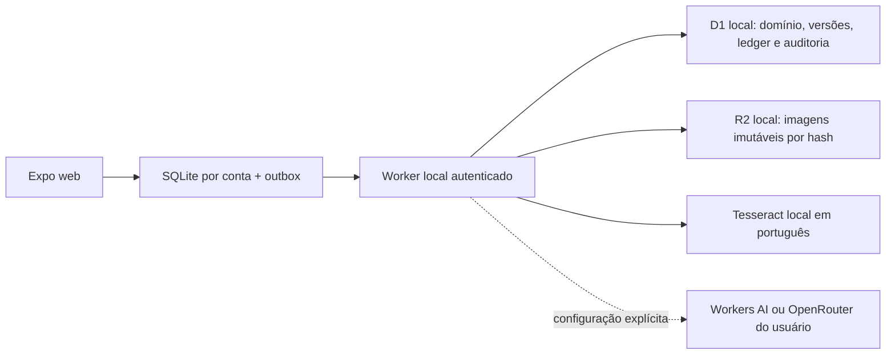

# Backend e execução locais da versão acadêmica

Conferência funcional: **06/11/2026**. Referência de compartilhamento atualizada em **09/11/2026**. Esta referência substitui a configuração Supabase na cópia da faculdade. A base original, suas migrations PostgreSQL e os documentos de outubro continuam como histórico e regressões; nenhum serviço remoto da aplicação foi usado nesta adaptação.

## Primeira execução

Na raiz do clone, use Node **24.10+ da linha 24**, npm, Python 3.10+ e Tesseract 5 instalado no sistema. A máquina de validação usou Node 24.22.2, Python 3.14.8 e Tesseract 5.5.4. O serviço OCR usa apenas a biblioteca padrão Python.

```sh
npm run setup:local
npm run build:web
npm start
```

`setup:local` instala pelos três lockfiles e obtém o modelo público português fixado. Downloads de pacotes/pesos são preparação; não são inferência hospedada. `npm start` verifica o modelo, aplica **somente migrations locais**, inicia OCR em `127.0.0.1:8091` e Worker + frontend em **http://127.0.0.1:8787**. D1 e R2 são emulados pelo workerd/Miniflare do Wrangler. Use essa mesma origem para manter sessão e SQLite; `localhost` é outra origem do navegador.

Se as dependências/modelo já estiverem instalados, a inicialização não precisa baixar pesos novamente. Não remova `.local/`, dados do site ou bancos para resolver erro de abertura. Um bloqueio transitório de OPFS recebe uma repetição limitada; erro persistente apresenta **Tentar novamente**, preservando os registros. Use uma aba por conta/origem; abas simultâneas no mesmo perfil podem disputar o pool OPFS do Expo.

Para editar com Metro, mantenha OCR/API locais e execute `npm run web` em outro terminal. O build também copia o WASM do player dotLottie e sua licença MIT do pacote fixado para `public/`, evitando o download padrão da biblioteca em CDN. O frontend Metro usa `http://localhost:8081`; o Worker autoriza essa origem e `127.0.0.1:8081`. Após recompilar o SPA, reinicie o Worker para atualizar o manifesto dos assets. `npm run build:web` acrescenta o service worker; `expo export` isoladamente não o acrescenta.

### Contas sintéticas

| Conta | E-mail | Vínculo |
| --- | --- | --- |
| Ana | `ana@agrogest.local` | Sócia da Fazenda Escola |
| Bruno | `bruno@agrogest.local` | Outro sócio; aprova a despesa de Ana |
| Camila | `campo@agrogest.local` | Funcionária; sem financeiro geral nem aprovação financeira |
| Diego | `isolado@agrogest.local` | Sócio de outra operação isolada |

Senha pública **exclusivamente de demonstração local**: `AgroGest2026!`. O servidor confere PBKDF2-SHA256, emite token aleatório, armazena somente hash de token no D1 e verifica sessão em cada requisição. Isso não é login por e-mail livre. Não há cadastro, envio de e-mail, confirmação por link nem recuperação operacional nesta versão; a interface informa essa limitação. As identidades de demonstração são pré-confirmadas. Elas precisam ser substituídas por uma solução de identidade adequada antes de futura hospedagem.

A carga inicial tem dados sintéticos: 10 novilhos, compra de R$ 10.000,00, peso de 300 kg e aluguel de pastagem zero. Migrations usam `INSERT OR IGNORE`, sem limpar dados já gravados.

## Roteiro demonstrável

1. Entre como Ana, abra **Despesa → Importar imagem de comprovante**. A antiga rota Nota fiscal também encaminha para esse importador real.
2. Escolha uma foto PNG/JPEG/WebP de até 8 MiB. Exemplos sintéticos reproduzíveis estão em `agrogest-app/tests/fixtures/comprovante-gs-001.png` e `comprovante-gs-002.png`. São imagens de teste, não notas fiscais autênticas.
3. A captura é salva no SQLite da conta **antes** do upload. O Worker guarda bytes no R2 local e metadata/hash no D1. O OCR recebe os bytes efetivos e retorna texto, palavras, caixas/confiança e campos; nada usa a antiga amostra constante.
4. Confira valor, data, fornecedor, descrição e número contra a imagem. Campo ausente permanece vazio; não há substituição silenciosa por resultado inventado. Confirme a revisão e prepare a despesa.
5. Escolha **categoria**, confira fazenda, parcelas e **rateio**. O importador não escolhe essas regras pelo usuário. Envie; com Ana e Bruno na operação, o status recebido é **Aguardando aprovação**.
6. Entre como Bruno em outro perfil/contexto do navegador ou saia de Ana e entre como Bruno. Abra o lançamento, confira **Ver comprovante original** e aprove. O autor e a funcionária não podem aprovar essa despesa financeira.
7. Abra o lote e veja custo acumulado, custo por cabeça e ponto de equilíbrio. Com apenas o comprovante GS-001 aprovado: **R$ 11.250,40**, **R$ 1.125,04/cabeça** e estimativa **R$ 112,50/@**. Antes da aprovação, a despesa não entra no custo confirmado. O indicador é calculado pelas funções originais do domínio; não é número fixo de tela.
8. Para demonstrar offline: extraia GS-002, conclua a revisão, desconecte a rede do navegador e envie. Reabra o aplicativo: a intenção fica **aguardando envio**, no SQLite/outbox. Reconecte, sincronize e somente depois aprove com Bruno. Fotografar offline também preserva a captura para analisar mais tarde; OCR/backend exigem conexão local disponível.

O documento é único por operação/hash e só pode estar vinculado a uma despesa. Repetir o mesmo comando retorna a confirmação anterior; reutilizar o ID com dados diferentes é recusado. A captura pode ser reaberta sem novo OCR. O anexo é acessível ao autor e a sócios autorizados; não há URL pública do R2.

## Contrato e armazenamento



| Fronteira | Implementação |
| --- | --- |
| Leitura | `POST /api/rpc/agrogest_workspace`: projeção por vínculos e cargo; funcionário não recebe coleções financeiras e custos de compra |
| Escrita | `POST /api/rpc/agrogest_command`: catálogo de 38 ações, ID do comando, payload, controle de versão e validações do domínio |
| Sessão | `/api/auth/login`, `/api/auth/user`, `/api/auth/logout`; sete dias de validade, verificação no servidor |
| Documentos | `POST /api/documents?operationId=…`, `GET /api/documents/:id`, `/content`, `POST …/extract` |
| Saúde | `GET /api/health`: distingue infraestrutura local e provedor de inferência |
| Persistência do servidor | `agrogest-app/.local/cloudflare/`, ignorada no Git; não apagar durante reinicializações |
| Persistência do cliente | SQLite v15, nome `agrogest-worker-local-<conta>.db`; `local_documents` fica fora da substituição de snapshots e a outbox é preservada |
| Migrations D1 | `0001_domain.sql`, `0002_local_demo.sql`, `0003_inference_usage.sql`, somente `--local` |

O arquivo `services/supabase.ts` é uma fachada compatível para as chamadas existentes da outbox, delegando ao cliente HTTP próprio. **Não importa SDK Supabase**. A dependência foi removida. Nomes RPC foram mantidos para reduzir risco de reescrever UI/regras ao mesmo tempo. `database.types.ts` ainda serve como tipo JSON histórico; não ativa conexão.

A gravação usa snapshot + revisão global e **batch D1 atômico**. O primeiro statement insere uma guarda com `CHECK(ok=1)` somente se revisão e sessão ainda forem válidas; falha aborta domínio, ledger, vínculo documental e auditoria juntos. Corridas repetem a leitura, revalidam e rejeitam revisão obsoleta. Não há uma sequência de writes soltos após um `UPDATE` que possa afetar zero linhas. A revisão global simplifica correção; não é uma solução de escala demonstrada.

O ledger tem chave `(ator, comando)` e payload canônico. Aprovação não altera a autoria; servidor determina status/histórico/revisão. Baixa altera caixa, não custo. Transferência mantém origem econômica e custo transportado. Membros removidos/permissões reduzidas são reavaliados inclusive no replay. Snapshot só substitui o cache sem comandos pendentes.

## Inferência e credenciais transferíveis

O padrão testado é **`INFERENCE_PROVIDER=local`**. O Tesseract 5 executa reconhecimento neural/CV, com `por.traineddata` do `tessdata_fast`, revisão `87416418657359cb625c412a48b6e1d6d41c29bd`, Apache-2.0, SHA-256 `c4932b937207a9514b7514d518b931a99938c02a28a5a5a553f8599ed58b7deb`. O parser de valor/data é determinístico; ele não é apresentado como um segundo modelo de IA. Dois recibos legíveis funcionaram; isso não mede acurácia em fotos rurais difíceis, DANFE, manuscritos ou PDFs.

Para configuração privada, copie **`agrogest-app/apps/api/.dev.vars.example` → `.dev.vars`**, edite no próprio arquivo e reinicie o Worker. Esse é o exemplo consumível pelo Wrangler. `config/inference.env.example` permanece referência histórica e aponta para ele. Nunca cole chave num comando, screenshot, commit, frontend ou log.

| Seleção | Variáveis do backend e comportamento |
| --- | --- |
| Local | `INFERENCE_PROVIDER=local`, `LOCAL_OCR_BASE_URL=http://127.0.0.1:8091`; sem token nem internet de inferência |
| Workers AI | `INFERENCE_PROVIDER=workers-ai`, `INFERENCE_REMOTE_ALLOWED=true`, `WORKERS_AI_ACCOUNT_ID`, `WORKERS_AI_API_TOKEN`, `WORKERS_AI_MODEL`; chamada REST HTTPS pelo Worker local, sem binding AI remoto |
| OpenRouter | `INFERENCE_PROVIDER=openrouter`, `INFERENCE_REMOTE_ALLOWED=true`, `OPENROUTER_API_KEY`, `OPENROUTER_MODEL`, `OPENROUTER_PROVIDER`; Responses API, schema estruturado, provedor fixo, sem fallback e com coleta desabilitada na solicitação |

Adaptadores remotos foram implementados, **sem chamada real nesta sessão**: credenciais/modelo de conta não foram fornecidos no ambiente de execução. Há limite de 20 solicitações remotas por conta do app/dia, timeout e limite de saída; falhas não disparam outro provedor. O limite de solicitações **não é teto monetário**. Defina orçamento/chave restrita no provedor antes do primeiro teste pequeno. Capacidade do modelo, formato e política do endpoint precisam ser confirmados no teste real. Erros do provedor não são registrados com headers/conteúdo secreto.

A conta que paga IA é independente das identidades do aplicativo e da futura hospedagem. Na transferência, o amigo recebe código, exemplos vazios e instruções de exportação/restauração; fornece suas próprias chaves e repete os testes. As credenciais temporárias do usuário não são transferidas. O `.git` próprio, origem/autor/commit e o clone de proveniência continuam preservados. O código é compartilhado pelo [repositório próprio público](https://github.com/badmuriss/agrogest); a [proveniência](../../ORIGEM_AGROGEST.md) registra a criação autorizada em 09/11/2026.

Referências de contrato: [Cloudflare REST](https://developers.cloudflare.com/workers-ai/get-started/rest-api/), [Scout](https://developers.cloudflare.com/workers-ai/models/llama-4-scout-17b-16e-instruct/), [OpenRouter Responses](https://openrouter.ai/docs/api_reference/responses/overview), [modelo português e licença](https://github.com/tesseract-ocr/tessdata_fast/tree/87416418657359cb625c412a48b6e1d6d41c29bd). A comparação com modelos Hugging Face, recursos e licenças está no [plano](../../PLANO_AGROGEST_CLOUDFLARE_LOCAL.md); nenhum Space/Endpoint hospedado foi usado.

## Rede e verificações

App, DB, arquivos e shell usam loopback. O probe NetInfo consulta a saúde da **API local**, sem ping de internet pública. Busca geográfica, tiles/CDN de satélite e base remota de mapas estão desativados; contornos/dados já existentes não são apagados. Nada ativa `remote:true`, `dev --remote`, Supabase remoto ou Workers AI binding. Somente a inferência explicitamente selecionada pode sair para seu endpoint autorizado. Publicar app para conseguir chamar um modelo não faz parte da solução.

```sh
npm run check  # tipos, lint e as três suítes abaixo
npm test
npm run test:api
python -m unittest discover -s agrogest-app/services/extraction -p 'test_*.py' -v
npm run typecheck
npm run lint
npm run build:web
npm run export:check
```

A suíte API inicia seu próprio OCR loopback e Miniflare com banco/R2 temporários, aplica as três migrations locais e não altera o estado da demonstração. Os testes PGlite originais executam SQL PostgreSQL **local em WASM**; são regressões da origem, não evidência de migração aplicada em Supabase remoto. As evidências datadas ficam em [Histórico](HISTORICO_REVISOES.md) e `research_notes/Agrogest Cloudflare local/`.

## Limites da entrega

RF-20 está **parcialmente atendido**: imagens → despesa com revisão, anexo e aprovação. PDF/XML, itens fiscais detalhados, autenticidade fiscal, rotação/correção automática, OCR de manuscrito e validação em corpus rural continuam pendentes. A interface não afirma validar fiscalmente um recibo.

O alvo validado é web Chromium local, com headers COOP/COEP e WASM. Exportar Android/iOS não prova execução em aparelho ou APK/IPA. Modelo local executa no computador do backend; não roda dentro do Worker nem no telefone. Auth de produção, recuperação/e-mail, performance em escala, política de retenção e backup/restauração operacional precisam de uma fase própria. Os 38 handlers reutilizam o domínio, mas não há cobertura exaustiva de todas as combinações do financeiro/estoque e dispositivos.

Cloudflare emulado e OCR local comprovam implementação compatível e IA/CV reais locais. **Ainda falta evidência de cloud efetivamente usada para a GS**. Uma chamada remota autorizada de inferência, com credencial configurada e resultado validado, pode suprir esse ponto sem deploy do aplicativo. Não anunciar hospedagem/cloud real com base na emulação.
