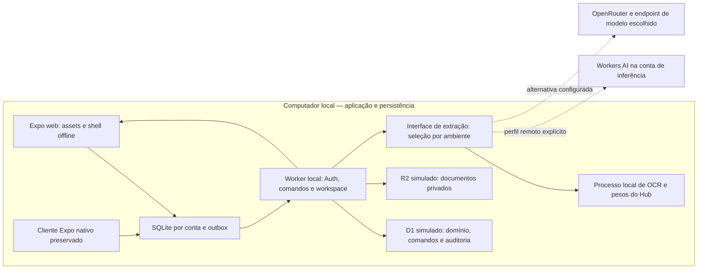

# AgroGest — plano e estado da implementação local

**Revisão 5 · 10/11/2026, preservando a implementação de 06–09/11 e a análise v2.** O desenvolvimento substituiu a antiga fase de somente análise. O código foi adaptado neste repositório; aplicativo e dados continuam locais. O OCR passa a ser empacotado em container Docker local por CPU, com modelo incluído e o mesmo contrato HTTP; [execução e limites](../CLOUDFLARE_LOCAL.md#ciclo-do-container-ocr). O repositório independente público é [badmuriss/agrogest](https://github.com/badmuriss/agrogest), publicado por autorização posterior do usuário. A análise v2, seu inventário, riscos, pesquisa e os 114 testes iniciais estão preservados abaixo como registro anterior à implementação.


Atualização: IA visual local Qwen3-VL-2B quantizada, executando na GPU desta máquina, integra imagem → campos em uma chamada. A revisão foi simplificada e a escolha da imagem abre diretamente no formulário de despesa. O parser TSV do OCR CPU e a invalidação de cache foram corrigidos. Setup, contas e limites permanecem no [guia operacional](../CLOUDFLARE_LOCAL.md); [evidências datadas](../HISTORICO_REVISOES.md) distinguem esta validação dos 114 testes iniciais e das execuções de 06 e 09 de novembro. Planos, pesquisas e histórico foram agrupados nesta documentação; a raiz ficou voltada aos avaliadores.
**Preparação de ambientes:** instalador por perfil, diagnóstico sem segredos e troca local/IA visual/Workers AI implementados. O início não exige Docker quando o provedor escolhido não o usa. Staging/produção têm configuração privada própria, origem HTTPS, migrações sem carga de demonstração e bootstrap de contas próprias. Frontend acompanha a origem hospedada; sessão/SQLite/outbox distinguem backend/conta sem renomear a base local atual. Publicação, provisionamento e inferência Cloudflare real continuam pendentes. [Procedimento e limites](../CLOUDFLARE_LOCAL.md#preparar-a-futura-hospedagem-cloudflare).

## Conferência da entrega e pitch técnico

Conferência em 10/11/2026 contra o enunciado integral reenviado pelo usuário. **O recorte é compatível com a proposta da GS**, mas não existe nota máxima garantida antes da avaliação do professor. Código, slides e quantidade de testes não substituem o vídeo, as evidências do problema ou a demonstração prática das quatro tecnologias. A apresentação refeita em 11/11/2026 é o [PDF de dez slides](pitch/agrogest-pitch.pdf), estruturado para **4min46s** de fala, com margem até os cinco minutos. A narrativa segue um único recibo sintético (GS-004) da foto ao custo do lote.

| Critério da rubrica | Peso | Como o pitch cobre | Conferência antes de gravar |
| --- | ---: | --- | --- |
| Proposta e problema evidenciado | 3 | Slides 1–2: compra que se perde entre campo e planilha (esquecida, digitada errado, lançada duas vezes), conforme o levantamento de requisitos; impacto no custo do lote | Juntar um relato autorizado/anonimizado ou observação documentada do público. O cenário funcional não comprova sozinho a frequência da dor |
| Público-alvo e mercado | 3 | Slide 3: produtor de recria/engorda, quem registra e sócio; legibilidade para meia-idade e mais velhos; contexto do Censo Agro 2017 e entrada por assistência/cooperativa | Não tratar os 77% da agricultura familiar como TAM específico ou clientes conquistados. Incluir meia-idade e pessoas mais velhas no recrutamento do piloto |
| Impacto e valor da solução | 3 | Slides 4–6: recibo e revisão lado a lado (IA sugere, pessoa decide), aprovação por outro sócio e custo do lote; quatro tecnologias no mesmo caminho e continuidade offline | Mostrar cliques reais, correção humana e comprovante vinculado. A IA não aprova despesas |
| Diferencial | 3 | Slide 7: comparar tarefas em caderno/planilha com sugestão, anexo, aprovação, sincronização e reenvio do mesmo arquivo | Não alegar que nenhum concorrente tem IA/offline. O diferencial proposto é a adequação ao recorte do produtor |
| Resultados e impacto esperados | 8 | Slide 5 (cálculo demonstrado) e slides 8–9: metas de piloto, método de comparação, implantação, continuidade e ODS 2.3 | Falar explicitamente em metas para os percentuais. Incluir falhas/correções/ajuda na medição e não inventar melhoria de renda ou conversão |

### Quatro tecnologias em uso no funcionamento

- **Visão computacional:** pixels do comprovante são processados pelo extrator; não usar resposta constante.
- **Inteligência artificial:** modelo visual organiza campos para revisão, com valores nulos quando desconhecidos e validação determinística. IA/CV podem ser funções do mesmo modelo; não é exigido treinar dois modelos.
- **Análise de dados:** custos por lote, por cabeça e equilíbrio decorrem do domínio, após aprovação. GS-004 demonstra acréscimo de R$ 42,50; não confundir cálculo com ganho de produtividade.
- **Cloud:** arquitetura Workers/D1/R2/Workers AI e [roteiro Wrangler](../CLOUDFLARE_LOCAL.md#deploy-com-wrangler-na-conta-do-responsável) estão preparados. **Antes da gravação que afirma cloud em uso**, o responsável deve publicar na própria conta e registrar URL/saúde e uma inferência real. Teste emulado/dry-run não comprova chamada hospedada. Essa execução não foi realizada nesta conferência. Em 11/11/2026 o usuário informou que a equipe publicou na Cloudflare; o slide de tecnologia passou a mostrar a nuvem como publicada. URL, saúde e leitura hospedada não foram conferidas pelo agente e devem aparecer na gravação.

### Indicadores, ODS e sustentação

As metas apresentadas são proposta de piloto: **cinco produtores, cinquenta comprovantes e duas semanas**. Alvos: redução de 30% da mediana do tempo por lançamento; 95% de acerto em valor/data legíveis; zero efeitos duplicados nos cenários de reenvio/reconexão. Cronometrar tarefas equivalentes manuais e assistidas, alternar ordem, incluir espera/correções/falhas, guardar gabarito por campo e registrar ajuda/compreensão da aprovação. Reportar amostra e dispersão, sem extrapolar a pequena avaliação. O modo claro padrão, com escuro opcional, é uma decisão de design a avaliar; não é ganho de conversão medido.

A ligação proposta com a **meta 2.3 do ODS 2** é acesso à informação para gerir recursos do pequeno produtor, apoiando decisões; renda/produtividade exigem outro acompanhamento. Fontes: [ONU, meta 2.3](https://sdgs.un.org/goals/goal2) e [IBGE, Censo Agropecuário 2017](https://agenciadenoticias.ibge.gov.br/agencia-sala-de-imprensa/2013-agencia-de-noticias/releases/25789-censo-agro-2017-populacao-ocupada-nos-estabelecimentos-agropecuarios-cai-8-8). O piloto acompanhado e a manutenção por operação/cooperativa são hipóteses de adoção/negócio; contabilizar suporte e consumo de infraestrutura.

### O que efetivamente vale como entrega

Gravar o pitch técnico com áudio compreensível, demonstrar o fluxo e manter duração **até 5:00**. Publicar no **YouTube como não listado**, conferir o link em uma janela sem login e enviar o URL real num arquivo **TXT ou ZIP na FIAP ON até 19/11/2026**. A atividade não tem a tolerância de três dias. HTML/PDF são apoio à gravação e **não substituem o vídeo obrigatório**. O vídeo Startup-One de até três minutos é opcional e não vale nota; não misturá-lo com o limite do pitch técnico.

Os principais riscos para a pontuação máxima são ausência de evidência direta do público/problema, cloud apenas conceitual, números esperados narrados como resultados obtidos, vídeo longo e falta de link válido entregue no prazo. A estrutura dos slides cobre os cinco critérios; a conclusão depende dessas ações e da apresentação final.

## Entrega implementada nesta revisão

- **Frontend:** Expo SDK 58/React Native web preservado, cliente HTTP próprio, sem SDK/conexão Supabase. `services/supabase.ts` é apenas fachada de compatibilidade para a outbox. A rota fiscal antiga encaminha para captura real; a amostra constante saiu do runtime.
- **Worker local:** autenticação por senha conferida no servidor, quatro contas sintéticas, sessões opacas com hash/expiração, catálogo de 38 ações, workspace por cargo/vínculo e revalidação de acesso. Cadastro/recovery/e-mail de produção continuam fora deste recorte.
- **D1 local:** três migrations aplicadas ao emulador, entidades do domínio, revisão, ledger, auditoria, metadata e vínculo de documentos. `batch` atômico começa com guarda de revisão/sessão e constraint; corridas não podem confirmar parcialmente domínio/ledger/documento.
- **R2 local:** imagens originais, hash por operação, autorização de leitura e vínculo único com despesa. Não existe bucket/URL pública remota.
- **IA/CV local real:** Tesseract 5, modelo neural `por` fixado, licença Apache-2.0 e checksum verificado; duas imagens distintas processadas com valores distintos, campos ausentes e imagem corrompida testados. O parser não é rotulado como modelo generativo.
- **Revisão e offline:** captura/resultado/correção persistidos em SQLite v15 por conta; `local_documents` não é apagada por refresh de workspace. Envio/aprovação offline continuam intenções da outbox até validação. Shell estático offline via service worker sem cache de API/documentos privados.
- **Indicadores:** funções originais de centavos, rateio, aprovação, custo e financeiro reutilizadas. A despesa de R$ 1.250,40 só passa a compor custo após aprovação de outro sócio. Pagamento/estorno altera caixa, sem reescrever custo.
- **Inferência remota:** somente Cloudflare Workers AI, com REST para o backend local e binding ou REST para o Worker futuramente hospedado. OpenRouter foi removido por instrução posterior do usuário. Timeout, schema, seleção explícita e ausência de fallback preservados. Não testados com conta real: credenciais ausentes. Isso não é evidência de cloud executada.

O [guia atual](../CLOUDFLARE_LOCAL.md) é a fonte operacional para comandos, arquitetura/contratos implementados, armazenamento, contas, transferência e testes. A execução usa `npm start` e **http://127.0.0.1:8787**; não há deploy ou provisionamento.

## Arquitetura aplicada e diferenças para a proposta

A arquitetura preserva Metro/Expo em vez de introduzir um segundo bundler no frontend. O Worker usa Wrangler local fixado no lockfile, com D1/R2 explicitamente `remote:false`, `workers_dev:false` e sem script de publicação. O alvo web exportado é servido como Assets locais; desenvolvimento com Metro em 8081 continua disponível. A escolha evita trocar o frontend e o backend simultaneamente.

O contrato inicial mantém `/api/rpc/agrogest_command` e `/api/rpc/agrogest_workspace`, compatíveis com as chamadas existentes, em lugar dos nomes `/api/v1/…` propostos na v2. A autorização é própria do servidor, sem Postgres RLS. Entidades JSON tipadas em D1 e uma revisão global simplificam a primeira migração, preservando atomicidade; escala e paralelismo por operação precisam de medição futura. Banco local antigo `agrogest-cloud-*` não foi apagado nem reutilizado por outra identidade de backend.

Auth web ainda usa sessão no localStorage da origem; cookie HttpOnly/identidade de produção é backlog. O importador atual é de **comprovantes para despesa**, não a NF-e completa planejada no RF-20. PDF/XML, itens fiscais e validação tributária não foram disfarçados como implementados. Satélite/geocodificação remotos estão desativados para respeitar a política de rede; geometria existente permanece preservada.

## Backlog que continua prioritário

| Prioridade | Pendência concreta | Critério para concluir |
| --- | --- | --- |
| P0 · GS/cloud | Configurar credencial restrita Workers AI e executar experimento pequeno autorizado pelo backend local | Imagem real, retorno real, campos/revisão/provedor/latência/uso registrados sem chave; nenhuma publicação do app |
| P0 · GS/qualidade | Ampliar corpus com fotos de campo, falhas e documentos sem campos; comparar esforço manual/assistido | Ground truth, erro por campo, tempo incluindo correções e casos de falha; sem extrapolar os recibos sintéticos das validações locais |
| P0 · entrega | Ensaiar e gravar pitch técnico de até cinco minutos, atendendo à rubrica | Evidenciar cada tecnologia efetivamente executada, autoria/reaproveitamento e limites; preparar link/arquivo da entrega sem publicação automática |
| P1 · produto | Completar PDF/XML/DANFE, itens fiscais, correção de imagem e detecção de duplicatas além de bytes idênticos | Subconjunto RF-20 especificado, validado com corpus e sempre sujeito a revisão/aprovação |
| P1 · identidade | Escolher e testar Auth definitivo, confirmação/recovery e sessão web HttpOnly | Login real, expiração/revogação, antiabuso e transferência das contas sem usar credenciais de demo |
| P1 · paridade | Expandir testes de cada combinação financeira/estoque, limites D1 e concorrência; validar dispositivos nativos | Comparação com domínio original, sem saldo negativo, vazamento entre contas ou mudança da política RF-16 |
| P1 · operação | Medir volume, definir retenção e ensaiar backup/restauração local | Restaurar D1/R2 e capturas sem perder vínculos, hashes, IDs e fila; não apagar o estado como atalho |
| P2 · hospedagem | Definir conta futura de hospedagem, endereço privado/autenticação do OCR CPU ou provedor remoto e custos | Repositório próprio público já definido; credenciais por ambiente, conectividade, custos e aceite validados antes de deploy/provisionamento do aplicativo |

## Aceite e evidências atuais

A matriz T01–T24 da análise abaixo permanece como contrato amplo. A execução atual comprova as fatias de imagem/extração real, revisão, autorização, outbox, aprovação, centavos, duplicação, concorrência e indicador cobertas pelos testes/roteiro do [histórico](../HISTORICO_REVISOES.md). A suíte herdada agora inclui PGlite local; suas migrations PostgreSQL não foram aplicadas remotamente nem convertidas em evidência D1.

O hardware foi usado para OCR português; a pesquisa Hugging Face abaixo continua válida como lista de candidatos licenciados, não como benchmark local executado. Workers AI não se tornou inferência local. A conta temporária de inferência do usuário segue separada da futura hospedagem/manutenção. O exemplo consumido agora é `agrogest-app/apps/api/.dev.vars.example`; `agrogest-app/docs/arquivo/inference.env.example` foi marcado como referência histórica.

**Nenhum deploy do aplicativo, provisionamento remoto, remote:true, Worker AI binding remoto, Supabase remoto foi realizado.** Os resultados de navegador e as contagens atuais são datados no histórico; os 114 testes anteriores e seus hashes permanecem inalterados.

---

## Registro preservado: análise e plano v2, anterior ao desenvolvimento

**Histórico, não configuração vigente:** a comparação de 06/11 inclui OpenRouter conforme autorização daquela data. Essa opção foi retirada em 10/11; não executar seus exemplos. O inventário, a pesquisa e as evidências iniciais são preservados. Para os cenários suportados agora, use o guia operacional e a revisão 5 acima.

Os verbos “planejado”, “futuro” e “não executado” no registro abaixo descrevem a revisão 2. O estado vigente e seus desvios estão nas seções acima e no guia operacional atual.


Revisão **2**, em **06/11/2026**, America/Sao_Paulo. Escopo de produto: **`agrogest-app/`**. O aplicativo é a versão de outubro do AgroGest; **nenhuma migração funcional do aplicativo foi iniciada** nesta revisão.

## 1. Decisão recomendada e limite desta entrega

Migrar o backend Supabase para **Workers + D1 + R2**, preservando o aplicativo **Expo/React Native**, sua exportação web, o SQLite por conta, a outbox e as regras de negócio. Servir a exportação web como assets do Worker. Separar transporte, identidade e persistência das regras puras para que cliente e servidor compartilhem cálculos e validações. Construir um único fluxo novo: **imagem de recibo de serviço → inferência real pelo provedor configurado → revisão → despesa existente → aprovação/sincronização → orçamento versus realizado**.

O caminho evita uma reescrita de interface e preserva o cliente nativo. O aplicativo atual já tem variante web; não existe um painel web independente em `agrogest-app/`. O legado não é fonte de funcionalidades deste plano.

**Aplicação, Worker de desenvolvimento, banco D1, armazenamento R2 e assets permanecem locais, sem deploy/provisionamento remoto.** Não usar Supabase remoto, exportação/migração de produção, túnel ou `dev --remote`. Bindings de dados/arquivos não recebem `remote: true`. A exceção autorizada é **inferência em Workers AI na conta do usuário e, como alternativa, OpenRouter com suas credenciais**, chamada por HTTPS a partir do backend local. Isso não exige publicar um Worker, criar D1/R2 remoto nem hospedar a imagem publicamente. O conteúdo da imagem pode sair para o provedor selecionado; a persistência do app continua local.

**OCR/CV local é preferência quando adequado, não obrigação.** Comparar modelos/pesos do Hugging Face executados neste computador com Workers AI e OpenRouter. Um download do Hub não é inferência hospedada; Spaces, Inference Endpoints e Inference Providers do Hugging Face são serviços remotos e não estão entre os provedores autorizados. Não exigir um modelo local ruim para obedecer à regra substituída e não trocar de provedor silenciosamente após erro.

O requisito acadêmico de cloud **ainda não foi demonstrado por esta equipe**. Emulação sozinha não o comprova. Uma chamada real de inferência em nuvem, integrada à imagem/revisão/indicador, pode demonstrar uso funcional de cloud no recorte da GS, sem deploy do aplicativo; isso precisa de evidência executada, não apenas autorização ou documentação. Não confundir essa evidência com hospedagem de Workers/D1/R2, que continua fora desta fase.

### Evidências da primeira análise, preservadas

- Leitura integral dos [requisitos da GS](REQUISITOS_GS.md) e do [README](../../../README.md).
- Leitura das instruções `AGENTS.md` da raiz e do mobile, dos guias de arquitetura/desenvolvimento/produto e inspeção das superfícies de interface, domínio, persistência, Auth, sincronização, migrations, arquivos e testes. O estado final do SQL foi considerado pela cadeia das **18 migrations**, não só pela migration inicial.
- Auditoria de 307 arquivos de texto da versão de outubro em cópia temporária; sem `.env`, credenciais, dados de usuários ou importação do app neste workspace.
- Execução de **16 arquivos de testes existentes: 114 testes passaram, zero falhas**, com Node `v24.22.2` e rede externa indisponível por namespace Linux (`unshare -Urn`). Abrangem domínio, relatórios, SQLite usado pelos serviços, permissões/projeções e sincronização com respostas controladas. Reprodução e limites na seção 12.
- Consulta a documentação oficial atual de Cloudflare, Expo SDK 58 e opções locais de OCR/Auth. Nenhum serviço de aplicação ou inferência foi chamado.

### O que foi feito nesta revisão

- Mantidas a análise de domínio e as evidências dos **114 testes anteriores**; esses testes não foram reexecutados nem reinterpretados como prova de IA.
- Consulta a model cards/licenças do Hugging Face, documentação Workers AI/OpenRouter, políticas e catálogo público de modelos. Nenhum peso de modelo foi baixado e nenhuma inferência foi executada. Configuração de exemplo sem segredos preparada em [config/inference.env.example](../arquivo/inference.env.example).
- Conferida somente a **presença**, sem inspecionar/exibir valores, das variáveis esperadas de inferência no processo. Não estavam configuradas; nenhum cofre/perfil privado foi vasculhado. Modelo, conta/token, rota e orçamento permanecem dependências para o futuro experimento.

**Continua não executado:** app/browser/mobile, build, lint, typecheck, as cinco suítes com PGlite, Worker, D1/R2 emulados, OCR sobre documentos, benchmark de modelos, inferência Workers AI/OpenRouter ou teste com produtor. Os testes anteriores não comprovam o backend PostgreSQL, o destino Cloudflare nem qualidade de extração.

### Repositório do projeto

O aplicativo vive em `agrogest-app/` neste repositório, público em [badmuriss/agrogest](https://github.com/badmuriss/agrogest). O `.gitignore` da raiz cobre segredos, estado e pesos locais. Nenhuma licença nova é presumida; a manutenção futura pode usar outro remote e configuração próprios, sem tokens temporários do usuário.

## 2. Matriz de aderência à Global Solution

O enunciado fornecido é a referência acadêmica. Documentação do produto descreve ambições adicionais e não deve ser confundida com a rubrica da GS. “Existente” abaixo significa código encontrado; a execução registrada é a baseline da primeira análise, separada das pesquisas e da preparação desta revisão.

### Quatro tecnologias obrigatórias

| Requisito | Estado atual e evidência | Lacuna | Alteração proposta | Critério de aceite |
| --- | --- | --- | --- | --- |
| Visão computacional | Captura/seleção de imagem existe; análise recebe apenas `file.name`. Tela (`agrogest-app/apps/mobile/src/app/novo/nota-fiscal.tsx#L100`), mock (`agrogest-app/apps/mobile/src/services/nf-extraction.ts#L48`). | Nenhuma leitura dos pixels no fluxo fiscal. | Novo importador recebe bytes e executa OCR/VLM local ou visão no provedor remoto autorizado, escolhido explicitamente. | T15: duas imagens distintas, inclusive com o mesmo nome, produzem campos correspondentes ao conteúdo; imagem ilegível gera pendência/falha explícita. |
| Inteligência artificial | `SAMPLE_EXTRACTION` fixa e uso simulado também em `syncAll`. Serviço (`agrogest-app/apps/mobile/src/services/nf-extraction.ts#L48`), workflow (`agrogest-app/apps/mobile/src/domain/workflow.ts#L190`), estado (`agrogest-app/apps/mobile/src/state/app-state.tsx`). | Não há inferência integrada nesse fluxo. Regras de parcelas/cálculos não são IA. | Provedor/modelo identificado, revisão de pesos se local, evidência por campo e revisão humana. OCR neural pode cumprir IA e CV no mesmo componente; interpretação adicional depende da POC. | T15–T17/T22: execução real identificável, entrada variável, resultado validado, erro sem fixture/troca oculta; nenhuma sugestão aprova/grava despesa sozinha. |
| Análise de dados | GMD, custos, estoque, caixa, DRE, centros de custo e orçamento implementados. Parte das regressões passou na primeira análise. Lotes (`agrogest-app/apps/mobile/src/domain/lot-metrics.ts#L134`), relatórios (`agrogest-app/apps/mobile/src/domain/reports.ts#L798`), financeiro (`agrogest-app/apps/mobile/src/domain/finance.ts`). | Falta validar o percurso da imagem ao indicador e preservar paridade no Worker. Não há impacto de campo medido. | Compartilhar domínio e usar orçamento por categoria como indicador da demo. Manter competência, caixa e estados provisórios distintos. | T01–T03/T17: a despesa revisada só altera o realizado quando aprovada, exatamente uma vez; conta manual fecha em centavos. |
| Cloud / computação em nuvem | Auth/outbox/RPC/workspace e SQL Supabase implementados; operação remota não verificada. Sync (`agrogest-app/apps/mobile/src/services/cloud-sync.ts#L12`), SQL (`agrogest-app/supabase/migrations/20261018222440_agrogest_foundation.sql#L265`). Destino Cloudflare e IA não implementados. | Emulação local não comprova cloud; nenhuma inferência remota foi executada. | Worker/D1/R2/Assets locais e opção de inferência Workers AI/OpenRouter chamada pelo backend. | T18/T19/T21 comprovam ambiente local. T22 poderá comprovar **inferência real em nuvem integrada ao produto**, sem alegar deploy de app/dados. Se apenas o provedor local for usado, a evidência cloud permanece pendente. |

### Cinco critérios do pitch técnico — 20 pontos

| Critério | Base atual / evidência | Lacuna e trabalho proposto | Evidência de aceite para o vídeo |
| --- | --- | --- | --- |
| Proposta e problema — 3 | Requisitos do autor atribuem o problema a entrevista com produtor de recria/engorda: transcrição, registros esquecidos/duplicados e apuração de custos. Requisitos do produto (`agrogest-app/docs/REQUISITOS_PRODUTO.md#L281`). | Validar uma tarefa concreta e sua consequência com produtor/operador; documentação do autor não mede prevalência. | V1: relato autorizado/anonimizado, método atual e uma tarefa observável; explicar vínculo com desenvolvimento rural/CitizenTech. |
| Público e mercado — 3 | Produtor e pessoa que registra a rotina são candidatos; pequeno produtor ainda é hipótese. Modo Essencial existe. | Identificar papel de quem captura, revisa e decide; aparelho, conectividade, apoio inicial e forma de adoção. | V1/V3: perfil/contexto e limites da amostra registrados; hipótese de adoção identificada como hipótese, sem mercado inventado. |
| Impacto e valor — 3 | Registro revisado pode alimentar indicador confiável; aprovação e rastreabilidade já têm base. | Medir esforço completo, erros e compreensão; não inferir renda, produtividade ou impacto climático. | V2/T17/T20: comparação manual/assistida com correções, tarefa concluída e explicação correta do resultado. |
| Diferencial — 3 | Uso de campo, revisão humana, papéis por operação, continuidade offline e cálculo explicável. | Comparar com a rotina real e alternativas que o participante já usa. Demonstrar contribuição de cada tecnologia. | V3: comparação documentada com planilha/registro atual; separar herdado/novo, infraestrutura emulada e inferência local ou cloud realmente executada. |
| Resultados e impacto esperados — 8 | Há cálculos/testes de software, mas nenhum piloto de utilidade/acurácia do importador. | Reservar tempo para validação, falhas, custos de execução/suporte e sustentabilidade. | V2–V4: planilha/registro de medições com denominadores, limitações e expectativas explícitas; vídeo de até cinco minutos, com espaço substancial para resultados. |

ODS **2.3** é candidato condicionado à validação do público e do acesso útil à gestão. Não afirmar duplicação de renda/produtividade ou contribuição climática comprovada. A relação deve ser justificada pela tarefa e pelos indicadores; os [requisitos fornecidos](REQUISITOS_GS.md) registram esse limite.

## 3. Inventário do aplicativo (versão de outubro)

### Estrutura, versões e funcionalidades

| Superfície | Encontrado no commit | Tratamento no destino |
| --- | --- | --- |
| Runtime e interface | Expo `~58.0.19`, React Native `0.88.0`, React `19.3.0`, Expo Router `~58.0.26`, TypeScript `~6.0.3`, NativeWind; npm com lockfiles independentes. Manifesto (`agrogest-app/apps/mobile/package.json`). | Preservar versões inicialmente. Não misturar migração de backend com upgrade de SDK, UI ou gerenciador. |
| Web | `app.json` define `web.output: single`; Metro configura WASM, COOP e COEP. Configuração (`agrogest-app/apps/mobile/app.json`), Metro (`agrogest-app/apps/mobile/metro.config.js`). | Exportar a mesma interface e servir assets/SPA no Worker. Testar headers e persistência de verdade no navegador. |
| Domínio | 23 módulos em `src/domain/`, sem dependência de React/Expo nos imports inspecionados. Regras puras, valores em centavos, datas de calendário e replays. | Compartilhar os módulos efetivamente consumidos pelo Worker, preservando contratos/testes; não copiar regras em implementações divergentes. |
| Campo e cadastros | Operações, fazendas, pastos/contornos, lotes/origem, pesagem medida/estimada, mortalidade, venda, manejo e transferência. | Preservar origem econômica, saldos por data, histórico e permissões. Não tratar transferência como venda. |
| Financeiro e estoque | Despesas/receitas, categorias, contraparte, compras/consumo/ajustes/transferências de insumo, parcelas, baixas e estornos. | Migrar validações, saldos e referências; obrigações e custo de consumo continuam derivados. |
| Gestão e análise | Contas/cartão/faturas, movimentos, sócios, financiamentos/SAC, renegociação, recorrência, orçamento, centros/finalidades, DRE/ponte para caixa, conciliação OFX/CSV e importação/exportação. | Inventariados como recursos a preservar na migração completa, mesmo que não apareçam no vídeo. |
| Pessoas | `socio` e `funcionario` são os dois papéis implementados; convites, aceite, cancelamento, troca/remoção de vínculo e proteção do criador. Tipos (`agrogest-app/apps/mobile/src/domain/types.ts`), SQL de pessoas (`agrogest-app/supabase/migrations/20261021100516_people_management.sql`). | Revalidar tudo no servidor. Perfis mais amplos dos requisitos são evolução, não funcionalidade atual. |
| Avisos e exportação | Avisos nativos locais; variante web não agenda notificações. Exportação web usa download/print local; `fetch(uri)` de arquivo selecionado não é necessariamente rede externa. | Preservar diferenças de plataforma; não prometer push ou alertas web agendados. Restringir leitura de URI a origem/blob/arquivo autorizado. |
| Arquivos e IA | Sem upload/binário persistente integrado. `NotaFiscalPayload` guarda metadados e resultado, não anexo. NF usa mock e é recusada no modo conectado. Tipos (`agrogest-app/apps/mobile/src/domain/types.ts`), tela (`agrogest-app/apps/mobile/src/app/novo/nota-fiscal.tsx#L100`), estado (`agrogest-app/apps/mobile/src/state/app-state.tsx`). | Construir documento/anexo e importador novos, sem desbloquear o módulo fiscal por remoção de guards. |
| Serviços externos adicionais | Photon, Nominatim, Leaflet em CDN, tiles ArcGIS e abertura de WhatsApp. Geocoding (`agrogest-app/apps/mobile/src/services/geocoding.ts#L54`), mapa (`agrogest-app/apps/mobile/src/components/farm-map/map-html.ts#L13`). | No perfil local, não carregar mapa remoto/geocodificação/CDN nem abrir integração externa. Coordenadas/contornos locais podem continuar disponíveis sem tiles. |

**Duas distinções de produto:** contexto de fazenda é filtro, não autorização independente. O vínculo atual autoriza a **operação**, que pode conter fazendas; a UI normalmente cria uma operação por fazenda. E os modos Essencial/Gerencial/Analítico alteram apresentação, jamais permissões ou fórmulas. Projeção (`agrogest-app/apps/mobile/src/state/workspace-selectors.ts#L19`), RF-15/RF-16 (`agrogest-app/docs/REQUISITOS_PRODUTO.md#L281`).

### Dependências Supabase a substituir

| Dependência | Uso atual | Substituição planejada |
| --- | --- | --- |
| SDK e ativação | `@supabase/supabase-js` `2.118.0`; duas variáveis públicas habilitam `cloudEnabled`. Cliente (`agrogest-app/apps/mobile/src/services/supabase.ts#L6`). | Cliente HTTP tipado para API e modo explícito `api-local`, independente de credenciais Supabase. Ausência de configuração não deve ativar login fictício no caminho integrado. |
| Auth | Cadastro/login, sessão persistida/refresh, logout, confirmação/reenvio, recuperação/atualização de senha, PKCE/deep link e verificação de usuário. Acoplado a `auth-state`, estado principal e telas de acesso. Auth (`agrogest-app/apps/mobile/src/state/auth-state.tsx#L34`). | `AuthProvider` próprio do aplicativo, com adaptador de identidade; autenticação local real/fixtures controladas e futura solução autohospedada compatível com Worker/D1. |
| Sessão por plataforma | SecureStore nativo com gravação em gerações; localStorage na web. `cloudToken` exige que usuário corresponda ao dono do SQLite. Cliente (`agrogest-app/apps/mobile/src/services/supabase.ts#L6`). | Preservar vínculo sessão/conta e isolamento. Preferir cookie HttpOnly no web e armazenamento seguro no nativo para o adaptador definitivo. |
| RPC de escrita | `agrogest_command(command_id, kind, payload)` usado pela outbox **e por chamadas diretas no estado**. | Dispatcher Worker `/api/v1/commands`, com mesmo catálogo de negócio, idempotência, controle de versão, auditoria e erros tipados. |
| RPC de leitura | `agrogest_workspace`, snapshot autorizado com redação de valores e coleções financeiras. | `/api/v1/workspace`, contrato versionado/validado e projeção autorizada no servidor. |
| SQL e isolamento | `private.*`, funções SQL/PLpgSQL, `auth.uid()`, `auth.users`, RLS/grants, locks transacionais/advisory, índices/constraints e JSONB. | D1 para estado SQL; TypeScript para dispatch/validação/projeção, constraints e gravação atômica no D1. D1 não oferece substituição automática de Auth/RLS/PLpgSQL. |
| Código gerado | `services/database.types.ts` descreve os dois RPCs públicos, sem tabelas públicas. | DTOs/API versionados e validação em runtime; não expor SQL ou tabelas genéricas ao cliente. |
| Storage/realtime | Não foi encontrada integração operacional de Supabase Storage ou assinatura realtime nesse fluxo atual; sync é por comandos/polling. | R2 é capacidade **nova** para documentos. Não há motivo demonstrado para introduzir realtime, filas ou outros produtos agora. |

### Catálogo completo de comandos

São **35 tipos na outbox** e **três adicionais por chamada direta**, totalizando **38**. A troca do arquivo `cloud-sync.ts` sozinha deixaria operações presas no Supabase. Fila (`agrogest-app/apps/mobile/src/services/cloud-sync.ts#L12`), chamadas no estado (`agrogest-app/apps/mobile/src/state/app-state.tsx`).

| Grupo | Comandos a preservar |
| --- | --- |
| Estrutura/campo — 11 | `create_farm`, `update_farm`, `create_pasture`, `update_pasture`, `delete_pasture`, `create_lot`, `update_lot`, `update_farm_boundary`, `update_pasture_boundary`, `place_lot`, **`transfer_lot`** |
| Pessoas — 5 | `invite`, `accept_invite`, `cancel_invite`, **`update_member`**, **`remove_member`** |
| Lançamentos — 3 | `save_entry`, `decide_entry`, `discard_entry` |
| Cadastros financeiros — 4 | `create_account`, `update_account`, `create_category`, `save_counterparty` |
| Insumos — 2 | `create_supply`, `update_supply` |
| Baixas/compra de lote — 3 | `register_payment`, `reverse_payment`, `set_lot_payment_plan` |
| Tesouraria — 5 | `register_movement`, `reverse_movement`, `save_financing`, `renegotiate`, `undo_renegotiation` |
| Planejamento/importação — 3 | `save_recurrence`, `set_budget`, `import_titles` |
| Gestão de custos — 2 | `save_cost_center`, `classify_cost` |

Os três em negrito exigem caminho conectado e confirmação; gestão de pessoas e transferência também exigem fila resolvida. Preservar essas condições inicialmente, sem anunciar todas as ações como offline. `save_entry` atende dez tipos de lançamento no domínio, mas NF continua bloqueada no cliente integrado; não contar esse tipo como extração suportada.

### Dados e mapa PostgreSQL → D1 → cache

Há **23 tabelas privadas** nas migrations e **17 tabelas locais**, incluindo a outbox; parte do financeiro local usa documentos JSON em `finance_docs`. O schema SQLite está na versão **14**. Schema (`agrogest-app/apps/mobile/src/db/schema.ts#L6`), repositório (`agrogest-app/apps/mobile/src/db/repo.ts#L66`), fundação (`agrogest-app/supabase/migrations/20261018222440_agrogest_foundation.sql#L265`), financeiro (`agrogest-app/supabase/migrations/20261022110210_finance_management.sql`), centros (`agrogest-app/supabase/migrations/20261027155902_cost_centers.sql`).

| PostgreSQL de outubro | D1 planejado | SQLite/semântica a preservar |
| --- | --- | --- |
| `profiles`, relação com `auth.users` | Perfis de domínio e mapeamento de identidade; tabelas de Auth separadas | `users`; manter UUIDs ou mapa explícito, sem deduzir identidade pelo e-mail informado no cliente. |
| `operations`, `memberships`, `farms` | Entidades relacionais com FK/escopo; adicionar revisão do agregado | Mesmas entidades; dono da operação, papéis e participações. |
| `pastures`, `lots` | Colunas de vínculo e payload JSON validado | Pastos, documentos de compra, localização, plano de pagamento e cadeias de transferência. |
| `entries` | Colunas indexáveis de operação/fazenda/autor/tipo/status/versão + JSON | Lançamentos, histórico, intenções offline; versão confirmada também em `settings`. |
| `invites` | Convites com e-mail normalizado e unicidade por operação | Contexto e aceite pela identidade verificada correta; convite não é vínculo/aprovador. |
| `commands`, `audit_events` | Livro de comandos/resultados e auditoria na mesma transação de negócio | `cloud_outbox` continua cliente; não se confunde com livro do servidor. |
| `financial_accounts`, `categories`, `counterparties`, `payments`, `supplies` | Tabelas equivalentes com índices, unicidade e constraints | Tabelas locais equivalentes; valores de estoque/obrigações continuam derivados. |
| `movements`, `financings`, `renegotiations`, `recurrences`, `budgets`, `titles` | Tabelas/documentos tipados por operação; unicidade de orçamento e importação | Coleções em `finance_docs`, sem multiplicar fatos financeiros. |
| `cost_centers`, `cost_classifications` | Tabelas/documentos com revisão própria, referências e histórico | `finance_docs`; reclassificar não altera versão financeira, parcelas, valor ou aprovação. |
| Sem equivalente integrado | `documents`, `extraction_runs`, `document_entry_links` | Novos metadados/rascunhos e arquivos por conta; R2 guarda bytes, D1 guarda relação/estado/hash. |

Conversões explícitas: UUID → TEXT validado; JSONB → JSON textual validado/indexado; booleanos → inteiro/contrato booleano; `bigint` monetário → INTEGER com limite seguro do JavaScript; data econômica → `AAAA-MM-DD`; timestamp → UTC ISO; `numeric` de participação/quantidade → escala e arredondamento documentados. Quantidades hoje usam `roundQty` a três casas. Reproduzir ordenação por ocorrência/criação/desempate, normalização de nomes/documentos, índices parciais/expressões e FK composta `(farm_id, operation_id)`.

Não converter as 18 migrations por substituição textual: há funções renomeadas `*_before_*`, validações sobrepostas e extensões de workspace. Produzir um schema D1 consolidado a partir do **estado final** e migrations novas, mantendo o SQL de outubro como referência de paridade.

### Cálculos e invariantes que não podem mudar silenciosamente

| Regra encontrada | Evidência / aceite de preservação |
| --- | --- |
| Rateio pelo maior resto; parcelas conservam centavos | Allocation (`agrogest-app/apps/mobile/src/domain/allocation.ts#L16`). Soma exata, desempate estável, percentuais válidos; T01. |
| GMD = diferença do peso médio entre base e última pesagem / dias | Métricas (`agrogest-app/apps/mobile/src/domain/lot-metrics.ts#L134`). Sem base temporal válida retorna nulo; medido/estimado identificados; T02. GMD por grupo/pasto tem regras próprias, não é média arbitrária de grupos. |
| Custo de lote por replay dos aprovados; compra + comissão + frete, apropriações e vendas parciais | Métricas (`agrogest-app/apps/mobile/src/domain/lot-metrics.ts#L134`). Morte conserva custo nos remanescentes como premissa atual; venda retira custo proporcional; transferência conserva origem/capital; T03. |
| Compra de estoque não vira custo integral dos lotes; consumo usa custo médio e rateio derivado | Estoque (`agrogest-app/apps/mobile/src/domain/stock.ts`). Última unidade absorve saldo de centavos; reservas, datas e ajustes respeitados; T03/T10. |
| Competência é distinta de caixa; pagamento não redata a despesa | Financeiro (`agrogest-app/apps/mobile/src/domain/finance.ts`), relatórios (`agrogest-app/apps/mobile/src/domain/reports.ts#L798`). Parcela pendente/rejeitada não cria obrigação confirmada; estorno não apaga história; T03. |
| Aluguel simbólico só altera resultado ajustado | Métricas (`agrogest-app/apps/mobile/src/domain/lot-metrics.ts#L134`). Nenhuma conta/saída de caixa criada; T03. Rendimento de carcaça estimado continua uma premissa identificada, não medida por imagem. |
| Realizado do orçamento soma despesas/NF aprovadas por ocorrência/categoria/escopo | Orçamento (`agrogest-app/apps/mobile/src/domain/reports.ts#L798`). `varianceCents = actualCents - budgetCents`; pagamento e revisão visual não substituem aprovação; T17. |
| Centro/agrupamento não duplica categoria/lote; reclassificação é documento separado | Centros SQL (`agrogest-app/supabase/migrations/20261027155902_cost_centers.sql`). Competência e gastos pagos preservam base, rateio de juros/descontos e origem em cartão/renegociação; T03/T19. |
| Projeções locais podem reservar baixas ainda não enviadas | Financeiro (`agrogest-app/apps/mobile/src/domain/finance.ts`): `SETTLING` inclui `aguardando_envio`; `CONFIRMED_PAYMENTS` contém só `efetivado`. Não confundir todos os números locais com confirmados; T12/T20. |
| Calendário/fuso precisam ser explícitos no servidor | `dates.todayISO()` usa o fuso do runtime; o SQL possui `sao_paulo_today`. Injetar relógio/data de negócio no Worker, sem herdar UTC inadvertidamente; T01. |

## 4. Arquitetura: aplicação local e fronteira de inferência



O diagrama representa o destino proposto, ainda não executado. SQLite nativo e web são instâncias de cada cliente. Um segundo perfil de navegador poderá demonstrar isolamento/sync contra o mesmo backend local. O Worker não executará binários Tesseract/Python/CUDA: no perfil local, chamará processo de loopback; no perfil remoto, chamará a API de inferência por HTTPS. Seleciona-se um caminho por ambiente/tentativa, sem fallback oculto. Não é necessário publicar o Worker ou criar Cloudflare Containers para chamar um modelo.

### Frontend e ferramentas

**Escolha:** manter o build Expo/Metro do frontend. Gerar sua SPA e servir pelo Worker com Static Assets, reservando `/api/*` para a API; erro de API nunca retorna `index.html`. Preservar callbacks/deep links e configuração SPA. A documentação oficial descreve [roteamento de SPA e prioridade de API](https://developers.cloudflare.com/workers/static-assets/routing/single-page-application/).

Para o **novo Worker**, preferir o plugin oficial Cloudflare para Vite, separado do bundler Expo. Ele executa o Worker em `workerd` local; não é motivo para converter a interface Expo para Vite. Fixar versões compatíveis no início da implementação. A [documentação atual do plugin](https://developers.cloudflare.com/workers/vite-plugin/) orienta esse contrato.

O projeto não possui configuração/dependência Cloudflare. No ambiente desta análise existem `cf 1.0.0-beta.26` e npm `11.19.1`; `wrangler` não está no PATH. Foram consultados apenas versão/help/descoberta do CLI. Não usar CLI global beta como dependência implícita, instalar automaticamente `latest`, presumir nomes de comandos `cf` a partir de Wrangler ou iniciar scaffolding nesta entrega.

No item B01, fixar a toolchain e verificar que servidor, migrations e fixtures usam **o mesmo diretório local persistente**. A descoberta local confirmou que `cf d1 migrations apply` aceita ID e flags `--local`, `--persist-to`, `--dir`; não aceita nome/binding como identificador. Caso se use Wrangler para os comandos de dados documentados, fixar sua versão e conferir os flags no CLI/schema instalado. Nada disso exige criar um banco remoto.

SQLite web exige WASM, `SharedArrayBuffer` e COOP/COEP; isso está documentado para o [SDK 58](https://docs.expo.dev/versions/v58.0.0/sdk/sqlite/). Reproduzir `Cross-Origin-Opener-Policy: same-origin` e `Cross-Origin-Embedder-Policy: credentialless`, testar `crossOriginIsolated` e MIME do WASM. Headers de assets e de respostas do Worker precisam ser tratados nas respectivas camadas: [`_headers` não modifica automaticamente respostas geradas pela API](https://developers.cloudflare.com/workers/static-assets/headers/).

**Lacuna web a resolver:** não foi encontrado service worker/cache do shell. SQLite sozinho preserva dados, mas não garante abrir a página do zero sem rede/servidor. Acrescentar cache local versionado dos assets necessários, sem cachear respostas privadas da API; testar reabertura fria, atualização de versão, OPFS e duas abas. Usar origem/porta estáveis, pois mudar a origem cria outro armazenamento web. Se houver incompatibilidade, preservar o nativo e registrar a limitação; não substituir SQLite por armazenamento volátil.

### Backend, API e domínio compartilhado

Estrutura proposta, **ainda não criada**:

```text
agrogest-app/
  apps/mobile/           Expo web/nativo, UI e SQLite preservados
  apps/api/              Worker: rotas, Auth, repositórios D1 e R2
  packages/domain/       regras puras usadas por cliente e servidor
  packages/contracts/    DTOs, schemas e códigos de erro
  services/extraction/   processo local, adaptadores OCR/modelo
  tests/                 regressões existentes + contratos/integração local
```

Extrair domínio por necessidade de dois consumidores, sem refazer o monorepo ou trocar npm. Manter compatibilidade temporária dos imports e adaptar o loader dos testes. O backend acrescenta autorização e validação autoritativa; compartilhar `workflow.ts` não transforma sua simulação local em backend seguro automaticamente.

| Superfície de API proposta | Contrato mínimo |
| --- | --- |
| `/api/health` | Estado do backend local e versão; sem dados privados. Usado para disponibilidade do servidor, não para provar acesso à internet. |
| `/api/auth/*` | Sessão/identidade, login/logout e contratos de recuperação/confirmação conforme o adaptador. |
| `POST /api/v1/commands` | `protocolVersion`, `commandId`, `kind`, `payload`; identidade vem da sessão, nunca do payload. Resultado autoritativo e versão. |
| `GET /api/v1/workspace` | Snapshot completo e autorizado com versão de schema, revisões e coleções obrigatórias; resposta incompatível não apaga cache. |
| `/api/v1/documents` e conteúdo por ID | Upload/consulta privada com estado, hash e autorização; sem bucket público ou URL externa arbitrária. |
| `/api/v1/documents/:id/extractions` | Iniciar/consultar tentativa de extração, registrando provedor/modelo e localização local/cloud. Resultado é rascunho, não lançamento; timeout remoto pode consumir inferência e não garante cobrança idempotente. |

Schemas devem validar JSON em runtime, tamanho, tipos, datas, centavos, referências e versões. Usar SQL parametrizado. Erros distinguem sessão ausente (401), ação/escopo negado (403), versão/identificador conflitante (409), dados inválidos (422), limite de arquivo (413) e indisponibilidade (503). Incluir código estável, mensagem revisável e indicação de retry. Um conflito de saldo representado como `Entry.status: conflito` pelo domínio não deve virar erro de transporte genérico.

### Auth e autorização

**D1 não substitui Supabase Auth.** Propor dois adaptadores com contratos separados:

1. **Laboratório local:** contas de fixture previamente cadastradas e sessões emitidas/validadas pelo servidor, expiráveis e revogáveis. O servidor decide a identidade; não aceitar seletor de usuário, e-mail livre ou header `X-User-Id` como prova de acesso. Seeds não provam propriedade de e-mail e não são Auth de produção. Não usar o login fictício atual para demonstrar segurança multiusuário.
2. **Auth definitiva candidata:** biblioteca autohospedada, inicialmente **Better Auth**, executada no Worker e com dados locais no D1 durante o desenvolvimento. Precisa de POC de runtime, senha/sessão, cookies, revogação, schema D1 e cliente Expo. A documentação confirma [suporte de banco SQLite/D1](https://better-auth.com/docs/concepts/database) e [integração Expo](https://better-auth.com/docs/integrations/expo), mas o guia Expo consultado é para SDK 55, enquanto o app usa 58; compatibilidade não está demonstrada. Não adotar plugins OAuth/SSO sem verificar suas exigências transacionais e necessidade real.

No local, confirmação/redefinição de senha pode usar caixa de saída **local** para testar tokens, uso único e callbacks; nenhum SMTP/serviço de e-mail externo. Seeds marcados como confirmados são atalhos de fixture, não confirmação real. Não extrair hashes, usuários ou sessões do Supabase remoto. Importação futura de identidades/dados e política de recuperação de conta exigem plano próprio.

Autorização permanece por operação e papel. O Worker reconstrói ator, autoria, histórico, status e decisão a partir da sessão e do estado; não aceita esses campos enviados pelo aparelho como autoridade. Preservar:

- Sócios gerenciam financeiro e vínculos; ninguém altera/remove o próprio acesso ou o do criador. Convite só vira vínculo após aceite pela conta correta.
- Autor nunca aprova o próprio lançamento. Financeiros exigem outro sócio **quando há elegível**; sem elegível, o servidor pode efetivar após validação. Baixas/movimentos seguem a exceção auditável já implementada. O comentário de `approval.ts` sobre divergência com RF-16 está desatualizado; o RF-16 vigente já documenta a exceção. Política (`agrogest-app/docs/REQUISITOS_PRODUTO.md#L281`), código (`agrogest-app/apps/mobile/src/domain/approval.ts#L18`).
- Funcionário mantém visibilidade de campo e de seus próprios lançamentos conforme o contrato atual; valores de compra/venda/estoque e coleções financeiras de terceiros precisam da redação do servidor. Não basta esconder a aba Financeiro. Anexos de despesas não herdam automaticamente acesso genérico a informações de campo.
- Toda referência a fazenda/lote/pasto/conta/centro precisa pertencer ao escopo autorizado; testar troca maliciosa de IDs mesmo quando o usuário participa de outra operação.
- Revogação/rebaixamento limpa a projeção e anexos acessíveis no próximo contato, inclusive quando há comando negado na fila. Cache offline existente não pode ser apagado remotamente de um aparelho desconectado; documentar prazo de sessão/acesso e limite do cache sem criptografia própria, sem prometer revogação instantânea offline.

### D1: atomicidade, concorrência e idempotência

Manter um D1 local compartilhado para o laboratório, com escopo de operação em todas as relações; não fragmentar operações participantes de uma transferência em bancos distintos. O SQL original usa locks de operação e de comando para impedir duplicação e excesso de saldo. D1 tem semântica SQLite; o desenho precisa substituir essas garantias, não apenas traduzir consultas.

**Estratégia inicial:** ler estado + revisão do agregado, calcular uma transição com regras compartilhadas e confirmar em um único `DB.batch`, contendo guard de revisão/permissão, alterações, resultado de comando e auditoria. A [API D1 documenta rollback de todo o batch se um statement falhar](https://developers.cloudflare.com/d1/worker-api/d1-database/). Um `SELECT` anterior ao batch, `await`s soltos ou um `UPDATE ... WHERE version = ?` que altera zero linhas **não bastam**: o guard deve provocar falha de constraint/checagem transacional para impedir que os demais writes sejam confirmados. A forma concreta é POC obrigatória B03, com SQL/constraints suportados no D1 local e teste de corrida; não está implementada neste plano.

Toda mudança relevante, inclusive permissões, saldos e referências, deve incrementar a revisão protegida. Transferência protege os dois agregados envolvidos no mesmo batch. Após disputa, reler e recalcular com retry limitado; não tornar leitura obsoleta válida à força. Não adicionar Durable Objects ou fila antes de provar que a solução D1 é insuficiente.

Livro de comandos com chave **`(actor_id, command_id)`**, tipo, payload canônico/hash e resultado durável. Mesmo ID/tipo/payload retorna resultado compatível sem novos efeitos; mesmo ID com outro conteúdo falha. Resultado, auditoria e efeitos devem confirmar juntos. Revalidar acesso antes de expor dados de replay; comando de usuário revogado não pode virar caminho para informação financeira antiga. UUID de arquivo ou hash não substitui o UUID do comando.

FK/uniques/CHECKs do D1 são defesa adicional, inclusive vínculos compostos entre fazenda e operação. [Foreign keys no D1](https://developers.cloudflare.com/d1/sql-api/foreign-keys/) não autorizam simplesmente desativar integridade para converter dados. Nenhuma gravação do cliente acessa D1 diretamente.

### Offline e troca de transporte

Preservar o ciclo atual: gravação otimista + outbox na mesma transação SQLite; envio em ordem; `expectedVersion: after-previous` resolvido e congelado antes da entrega; ACK/versão + remoção da fila atômicos; substituição do snapshot apenas sem pendências e com nova checagem dentro da transação. Sync (`agrogest-app/apps/mobile/src/services/cloud-sync.ts#L12`), repositório (`agrogest-app/apps/mobile/src/db/repo.ts#L66`).

Criar uma interface de transporte para comando/workspace e migrar **todos** os call sites diretos, Auth/telas e flags. Manter serialização de tarefas por banco/conta, timers/listeners com cleanup e proteção contra resposta antiga após logout/troca de conta. Erro de negócio não gera descarte automático da fila; oferecer resolução explícita do comando bloqueador.

Abertura fria sem API não pode depender obrigatoriamente de um refresh bem-sucedido para localizar os dados da conta já autenticada. B05/B08 devem definir acesso offline ao cache dessa conta, com identidade previamente verificada, prazo/política explícitos e estado provisório. Login inicial de uma conta nova exige o servidor; sessão expirada/revogada bloqueia envio até nova autenticação, sem apagar banco/outbox. Testar separadamente reinício offline com sessão ainda válida, expiração durante a tarefa e retorno do servidor. Cache local não concede permissão ao backend.

Separar disponibilidade da **API local** de acesso à internet. O `NetInfo` atual considera `isInternetReachable`; uma máquina sem WAN pode acessar perfeitamente seu Worker local. O perfil local precisa usar health/probe local e impedir sondas públicas de conectividade. Testar reconexão da API com internet desligada, sem depender de um endpoint público.

Preservação do banco/outbox: acrescentar versão de protocolo e identidade do backend/autoridade à configuração da conta/fila. Bancos e comandos originados no Supabase não podem ser enviados automaticamente ao Worker só porque o UUID do usuário coincide. Fazer backup e migração aditiva; se houver comandos antigos, mantê-los identificados e exigir mapeamento/importação explícita antes de replay. Não executar `wipeDatabase`, recriar cache ou reaproveitar o trecho destrutivo de migração v1 como estratégia de conversão.

## 5. Fluxo vertical de importação visual de despesa

### Recorte e persistência

Usar **recibo de serviço/despesa operacional simples**, inicialmente imagem JPEG/PNG de uma página, sem compra para estoque, parcelamento novo ou recorrência. O módulo de NF permanece com seu bloqueio. O importador é uma entrada para o formulário `novo/despesa`, cujo dispatch e validações existentes serão aproveitados. Formulário (`agrogest-app/apps/mobile/src/app/novo/despesa.tsx#L145`). PDF/HEIC exigem conversão local validada; não anunciar suporte automático no primeiro aceite.

1. Capturar/selecionar **bytes reais**, identificar tipo, tamanho e hash; persistir a cópia local por backend/conta antes de depender de rede. URI temporária do picker/estado React não garante reabertura. No nativo, usar armazenamento persistente de arquivos; no web, OPFS/IndexedDB para blobs e metadados no SQLite, com quota/falhas tratadas.
2. Criar documento privado e subir ao **R2 local** via Worker, com ID estável e retry. D1 registra operação, autor, hash, tipo, tamanho e estado. Propor inicialmente limite de 8 MiB/20 megapixels por imagem, validado no código e na UI; são limites de produto propostos, não limites declarados da Cloudflare.
3. Solicitar uma tentativa pelo provedor configurado. Worker verifica acesso e envia os bytes ao processo local ou à API autorizada. No perfil remoto, usar conteúdo inline/base64 conforme o contrato do modelo, sem expor R2 local ou criar URL pública. Não aceitar URLs arbitrárias ou caminhos de arquivo fornecidos pelo cliente.
4. Guardar resultado e proveniência: ID/hash do documento, provedor/modelo, revisão de pesos se local, perfil não secreto, request ID seguro, duração, uso/custo informado quando disponível, campos/evidências e erro. Estados distintos: capturado, aguardando processamento, processando, pronto para revisão, falhou e associado. Uma tentativa interrompida não cria despesa; retry de inferência remota pode custar novamente.
5. Validar JSON e mostrar imagem/evidência junto dos campos sugeridos. Ausente/ilegível/ambíguo permanece nulo/pendente; confiança bruta não equivale a probabilidade de acerto. Dados do documento são entrada não confiável, inclusive para eventual modelo de linguagem.
6. Preencher um **rascunho de importação para despesa**, sem reutilizar como se fosse uma NF completa. Sugerir total, data, descrição, fornecedor/número quando sustentados pelo documento. Categoria, fazenda, centro de custo, contraparte e rateio exigem associação e confirmação humanas. Vencimento não presente não é fato extraído; parcela única/default deve aparecer como escolha do usuário.
7. Após revisão explícita, passar pelas validações de `saveEntry(kind: despesa)`. Persistir a relação documento→lançamento e o comando; sincronizar dependências antes de referenciar documento inexistente. Revisão visual **não é aprovação**. Com dois sócios elegíveis, o autor submete e o outro aprova; só então o realizado muda.
8. Reabrir o lançamento e seu documento autorizado, conferir indicador e testar falha/reenvio. Se extração estiver indisponível, informar isso e permitir despesa manual; nunca retornar `SAMPLE_EXTRACTION` como fallback.

R2 e D1 não têm uma transação distribuída única. Modelar upload em duas etapas com estado pendente/confirmado: timeout após `put` deve reconciliar pelo ID/hash; D1 não pode declarar arquivo pronto antes de verificá-lo. Prever retomada e limpeza **local**, por rotina explícita, de objetos órfãos. Não apagar documento usado nem outbox no retry.

Duas deduplicações são necessárias: **entrega do comando**, pelo livro de idempotência; e **reimportação do documento**, por documento/hash e relação única com a despesa deste recorte. A mesma foto renomeada/reprocessada não gera segunda despesa. Outra foto do mesmo recibo pode ter hash distinto: sinalizar possível duplicidade por campos revisados, sem prometer deduplicação universal nem bloquear automaticamente recibos legítimos de mesmo valor.

### Modelos locais do Hugging Face: licença, recursos e qualidade

A inspeção de hardware da **primeira análise**, preservada como fotografia, encontrou Linux x86_64, i5-14600K/20 CPUs lógicas, cerca de 31 GiB RAM e RTX 4070 SUPER com 12.282 MiB VRAM total/6.555 MiB livres naquele instante. Tesseract **5.5.4** tinha apenas `eng`/`osd`, sem `por`; Python era **3.14.8**. Memória livre varia; wheels, CUDA e latência não foram validados. Nesta revisão foram lidos **cards, licenças e metadados públicos**, sem instalar runtime ou baixar pesos.

| Candidato local | Licença verificada e função | Recursos/instalação | Qualidade e escolha proposta |
| --- | --- | --- | --- |
| Tesseract LSTM + `por` | Engine neural de OCR, sem interpretação gerencial. [Uso oficial](https://tesseract-ocr.github.io/tessdoc/Command-Line-Usage.html), [projeto Apache-2.0](https://github.com/tesseract-ocr/tesseract) e [dados de idioma](https://github.com/tesseract-ocr/tessdata_fast). | CPU; binário já disponível, dados de português ainda necessários. Pré-processamento/rotação e parser local são componentes distintos. | Baseline de baixo esforço, não obrigação de mantê-lo se as fotos falharem. Nenhum acerto/tempo foi medido no corpus. |
| **`PaddlePaddle/PP-OCRv5_mobile_det` + `PaddlePaddle/latin_PP-OCRv5_mobile_rec`** | Cards do [detector](https://huggingface.co/PaddlePaddle/PP-OCRv5_mobile_det) e do [reconhecedor](https://huggingface.co/PaddlePaddle/latin_PP-OCRv5_mobile_rec) declaram **Apache-2.0**. Detecção de regiões + reconhecimento de linhas; não basta baixar apenas o reconhecedor. | Cards oferecem CPU/GPU via PaddlePaddle/PaddleOCR. Fixar versões suportadas em ambiente isolado, paths de todos os pesos e limites de imagem; não presumir wheels para Python 3.14. | **Primeiro candidato do Hub para OCR local**. Português consta na [tabela oficial multilíngue](https://github.com/PaddlePaddle/PaddleOCR/blob/main/docs/version3.x/algorithm/PP-OCRv5/PP-OCRv5_multi_languages.en.md). O card latino contém título/texto inconsistentes sobre `server_rec`/coreano: usar a identidade dos pesos e validar no corpus, sem tratar exemplos do card como garantia. |
| **`PaddlePaddle/PaddleOCR-VL-1.6`** | [Card e LICENSE Apache-2.0](https://huggingface.co/PaddlePaddle/PaddleOCR-VL-1.6); modelo especializado em documentos, com reconhecimento de texto/layout/elementos. A versão 1.5 aponta a 1.6 como sucessora. | Metadados indicam 958.588.736 parâmetros BF16: aproximadamente **1,92 GB só de pesos a dois bytes/parâmetro**, cálculo de ordem de grandeza, não requisito de VRAM. Somam-se buffers, ativações e componentes de layout. Card indica PaddleOCR `doc-parser` e alternativa Transformers 5; validar o ambiente e o pipeline completo. | **Segundo candidato local se OCR compacto não bastar**. O autor relata 96,33 no OmniDocBench v1.6; é benchmark de parsing do autor, **não acurácia de recibos brasileiros nem resultado do AgroGest**. Medir os campos da despesa e custo total de instalação/uso. |
| `Qwen/Qwen2.5-VL-3B-Instruct` | O [LICENSE do próprio modelo](https://huggingface.co/Qwen/Qwen2.5-VL-3B-Instruct/blob/66285546d2b821cf421d4f5eb2576359d3770cd3/LICENSE) é **Qwen Research License**, com uso não comercial e necessidade de licença para uso comercial. Não herdar a licença Apache do código/runtime. | Metadados: cerca de 3,75 bilhões de parâmetros BF16, aproximadamente **7,51 GB só de pesos**, antes de buffers/contexto; isso supera a VRAM livre da fotografia anterior. Quantização/offload muda o cenário e exige teste próprio, incluindo processador visual. | Mantido como alternativa de pesquisa, **não padrão de passagem ao responsável**. A escolha acadêmica não resolve licença de eventual operação comercial. Não presumir qualidade de campos/português a partir de demonstrações gerais. |

Revisões do Hub consultadas: detector `0d63e78e2b680928f6b1747d76a08db6e645efb7`; reconhecedor latino `ab2cd5cc5fa6309be2e5acdfe66eca2c2c127d57`; PaddleOCR-VL-1.6 `132c45f52c0a26ed5a6b2f6bd8e3985794cc27dd`; Qwen `66285546d2b821cf421d4f5eb2576359d3770cd3`. Fixar revisão/licença e hash dos pesos efetivamente baixados no experimento; não usar apenas `main`. Licença dos pesos, licença do runtime e licença da base AgroGest são coisas distintas.

**Hugging Face é origem de artefatos nesta opção.** Download público de pesos/configuração faz parte da preparação; inferência é local quando esses arquivos são carregados em runtime local. `InferenceClient`, Space, notebook Colab remoto, Inference Providers ou Endpoint hospedado continuam remotos, mesmo exibindo o mesmo model ID; não serão usados como alternativa não autorizada. Após preparar os artefatos, verificar [modo offline do Hub](https://huggingface.co/docs/huggingface_hub/package_reference/environment_variables) e carregamento por caminhos locais, sem fetch automático. Downloads e dependências devem ter escopo definido; nenhum peso pesado foi baixado neste diagnóstico.

### Comparação de execução: local versus Workers AI versus OpenRouter

| Caminho | Contrato e capacidade documentada | Custo/privacidade/limite | Papel no plano |
| --- | --- | --- | --- |
| **Local, pesos do Hub** | Backend local chama processo local; OCR neural pode atender CV e IA no mesmo componente. Parser/cálculos permanecem determinísticos. Sem chave de inferência hospedada. | Usa CPU/GPU, energia, instalação e manutenção locais. Não há taxa de API de modelo, mas não é custo zero. Qualidade em total/data e documentos ausentes precisa ser medida. | Preferido quando passar nos aceites com recursos/latência adequados. Não bloqueia a alternativa remota autorizada. Apenas local + emulação não demonstra cloud real. |
| **Workers AI do usuário** | [REST API oficial](https://developers.cloudflare.com/workers-ai/get-started/rest-api/): backend local chama `POST https://api.cloudflare.com/client/v4/accounts/{account_id}/ai/run/{model_id}` com token. Candidato: [`@cf/meta/llama-4-scout-17b-16e-instruct`](https://developers.cloudflare.com/workers-ai/models/llama-4-scout-17b-16e-instruct/), anunciado com visão e schema/JSON guiado. Conferir formato de imagem e saída do modelo no primeiro teste. | Modelo é executado **na nuvem**. O card informa US$ 0,27/M tokens de entrada e US$ 0,85/M de saída em 06/11; isso não é preço por recibo. A [tabela da plataforma](https://developers.cloudflare.com/workers-ai/platform/pricing/) explica cobrança/neurônios; saldo/plano do usuário não foram consultados. | **Primeiro provedor remoto autorizado**, caso o local seja inadequado ou para demonstrar cloud no fluxo. Não precisa de deploy/binding `ai` ou recursos D1/R2 remotos; usar REST explícito para isolar a fronteira. |
| **OpenRouter do usuário** | [Image Inputs](https://openrouter.ai/docs/guides/overview/multimodal/image-understanding): imagens privadas podem seguir inline/base64 pela Responses API `/api/v1/responses`; saída estruturada usa `text.format` quando suportada. [Structured Outputs](https://openrouter.ai/docs/guides/features/structured-outputs). O [catálogo público](https://openrouter.ai/api/v1/models) consultado lista `meta-llama/llama-4-scout` e `google/gemini-2.5-flash` com imagem e parâmetros de JSON. | Preço/capacidade depende do endpoint/provedor e pode mudar. Catálogo observado: Scout US$ 0,10/M entrada e US$ 0,30/M saída; Gemini 2.5 Flash US$ 0,30/M e US$ 2,50/M. São anúncios de catálogo, não cotação do endpoint escolhido nem custo final, crédito disponível ou teste de qualidade. | **Alternativa explicitamente configurada**, não fallback automático de Workers AI. Fixar modelo e endpoint/provedor permitido; não usar roteador `auto` ou modelo gratuito como garantia de visão, estabilidade ou retenção. |

Qualidade do JSON não garante fidelidade factual. Um VLM pode inventar valor/data com JSON válido; todos os caminhos precisam de evidência, validação do domínio e revisão. Comparar o mesmo corpus/campos, incluindo captura, espera e correções. Metadados de modelos/benchmarks são evidência de **capacidade declarada**, nunca execução ou resultado desta equipe.

Workers AI documenta [não uso para treino e retenção de conteúdo limitada ao processamento em inferência padrão, com condições/exceções e metadados operacionais](https://developers.cloudflare.com/workers-ai/platform/data-usage/). OpenRouter tem [política própria](https://openrouter.ai/docs/guides/privacy/data-collection) e [políticas dos provedores finais](https://openrouter.ai/docs/guides/privacy/logging); não assumir que são iguais. Para o experimento usar documentos sintéticos/anonimizados, desativar logging de conteúdo e restringir o endpoint escolhido. [`provider.only`, `allow_fallbacks: false`, `require_parameters: true` e `data_collection: deny`](https://openrouter.ai/docs/guides/routing/provider-selection) são controles a validar; exigir ZDR quando necessário e disponível, sem trocar silenciosamente de endpoint se a combinação não existir. Não ativar Files API persistente, ferramentas externas ou busca web para extrair um recibo.

**Decisão operacional B02:** avaliar baseline Tesseract/PP-OCRv5 local com timebox; considerar PaddleOCR-VL se o ganho justificar instalação. Se o local não atingir qualidade/utilidade adequada, usar Workers AI autorizado e manter OpenRouter como alternativa escolhida por configuração. Pode-se antecipar o teste remoto pequeno para não consumir o prazo com instalação local. Escolha final depende de acerto de campos críticos, latência completa, licença de continuidade e custo observado; não depende de insistir na preferência local.

Antes do teste remoto: provedor/modelo explícitos, chave própria desse ambiente, orçamento por rodada, no máximo dois documentos sintéticos inicialmente, limite de saída e uma tentativa automática por documento. Não mudar plano de cobrança, comprar créditos ou habilitar produtos adicionais silenciosamente. Timeout pode significar inferência já cobrada: registrar tentativa inconclusiva e não tratar retry como gratuito. Valor por documento só será calculado com uso real retornado e regras do endpoint; imagem/contexto/raciocínio/retries podem alterar o custo.

Interface conceitual `DocumentExtractionProvider`: recebe ID/hash, bytes de imagem e idioma; retorna campos opcionais, evidências, avisos, provedor/modelo/revisão, local de execução (`local` ou `cloud`), duração, uso disponível e erro tipado. Nenhum adaptador conhece permissão para aprovar despesas. Os três adaptadores compartilham contrato e validação; SDKs, credenciais e diferenças de payload ficam no backend, sem acoplamento ao domínio ou segredo no cliente.

“IA local” significa no computador do processo, não inferência embarcada em qualquer celular. O perfil remoto requer internet para a **extração**; registro/captura/rascunho e sincronização com a API local não devem depender disso. Sem provedor acessível, guardar a captura ou permitir entrada manual, sem mock e sem troca oculta. Nenhuma promessa de diagnóstico animal, emissão/validação fiscal ou recomendação contábil integra o recorte.

### Contas, credenciais e passagem da manutenção

| Responsabilidade | Agora | Passagem para o responsável |
| --- | --- | --- |
| Código da faculdade | Repositório público do projeto; sem novo remoto definido. | Escolher proprietário/nome/visibilidade antes de publicar. Entregar commits e documentação. |
| Hospedagem e dados da aplicação | Worker/D1/R2/Assets locais; sem conta cloud de hospedagem escolhida, dados sintéticos locais. | **Preferência de governança:** o responsável controla a futura hospedagem/dados e orçamento. Hospedagem temporária na conta do usuário é alternativa ainda não escolhida; exige decisão de destino, acesso, exportação/restauração e autorização de deploy próprias. |
| Inferência temporária | Workers AI do usuário, ou OpenRouter com sua chave, somente pelo backend local e no escopo autorizado. | O responsável configura chave/conta próprias e repete o teste pequeno; não recebe a credencial temporária do usuário. A troca não altera IDs de produtor/operação, regras ou DB. |
| Auth do aplicativo | Identidade de sócios/funcionários conforme B05; é diferente da conta Cloudflare/OpenRouter que paga inferência. | Preservar autenticação/isolamento do domínio, independentemente de quem financia o modelo. |
| Pesos locais | Configurar ID, revisão, diretório e licença; sem pesos no Git. | Documentar download/reprodução e recursos mínimos medidos; manter notices/licenças aplicáveis. Não presumir licença comercial por uso acadêmico. |

[config/inference.env.example](../arquivo/inference.env.example) contém somente nomes/valores de exemplo do contrato futuro: `INFERENCE_PROVIDER`, `INFERENCE_REMOTE_ALLOWED`, `INFERENCE_RUN_BUDGET_USD`, limites, `LOCAL_MODEL_ID/REVISION/DIR`, `WORKERS_AI_ACCOUNT_ID`, `WORKERS_AI_API_TOKEN`, `WORKERS_AI_MODEL`, `OPENROUTER_API_KEY`, `OPENROUTER_MODEL` e restrições de endpoint. **Ainda não há adapter que consuma esse arquivo.** O padrão fechado do exemplo não revoga a autorização remota: selecionar `workers-ai` ou `openrouter` explicitamente basta dentro do escopo já autorizado, após configurar os parâmetros necessários.

Valores privados ficam em `.dev.vars`/`config/.env.local` ignorados pelo Git ou no mecanismo seguro do ambiente, nunca em `EXPO_PUBLIC_*`, `app.json`, bundle, comando com chave literal, log ou screenshot. Não reutilizar automaticamente credencial/Account ID de deploy para inferência: os nomes `WORKERS_AI_*` mantêm essa responsabilidade separada. O token deve ser restrito à conta de inferência e às permissões necessárias; a [documentação REST](https://developers.cloudflare.com/workers-ai/get-started/rest-api/) informa **Workers AI Read e Edit** para token customizado, sem exigir permissões de deploy/D1/R2. Para OpenRouter, preferir chave por projeto/ambiente com limite/validade quando suportados; não chave de administração.

Verificação desta revisão: variáveis esperadas de token/chave não estavam presentes no processo, e não há configuração privada desta adaptação criada. Nenhum outro perfil/cofre foi inspecionado. **Dependência registrada**, não bloqueio da análise: fornecer configuração por canal seguro antes de executar B02/T22; não colar chaves na conversa/documentos. Não houve tentativa de autenticação, consulta de saldo/conta ou inferência.

Aceite da passagem: pessoa responsável usa o repositório sem chave do usuário, escolhe o próprio perfil, executa dois documentos sintéticos e vê resultado/revisão/indicador; logs/bundle/Git não contêm segredos nem IDs pessoais fixos. Só depois de validar o novo ambiente, o usuário poderá revogar suas chaves temporárias. Não mover credenciais nem operar contas para concluir este plano.

## 6. Backlog priorizado, dependências e condição de conclusão

A preparação de repositório **B00 está concluída** nesta revisão; os demais itens permanecem planejados, salvo exemplos/documentação de B15 já preparados. Prioridade indica risco/valor e ordem de liberação; porte é relativo, não estimativa contratual. POCs curtas de risco devem ocorrer antes da migração ampla. Preservar o código original até existir equivalência testada.

| ID / prioridade / porte | Trabalho e valor | Depende de | Saída/aceite objetivo |
| --- | --- | --- | --- |
| B00 — P0 / pequeno — concluído | Repositório do projeto preparado com o app em `agrogest-app/`, documentos e log TAP preservados. | Atualização do usuário | App presente, sem Git aninhado e sem novo remoto. T23 verifica a preparação. |
| B01 — P0 / médio | Fundação local: versões fixas, D1/R2/Assets locais, persistência única, perfis de rede e scripts que não provisionam. | B00 | T18/T21; boot do app/dados sem chave cloud; inferência remota opcional por REST explicitamente autorizado, sem binding remoto de dados/arquivos. |
| B02 — P0 / POC curta | Comparar OCR local/Hugging Face com Workers AI e alternativa OpenRouter; definir pesos/licença ou modelo/endpoint remoto, orçamento e corpus. Preferência local não bloqueia remoto adequado. | B00; configuração segura para chamada remota | T15/T16/T22; dois documentos distintos, ausências/falha reconhecidas, campos/latência/recursos/uso medidos. Timebox inicial local de meio dia útil; testar remoto pequeno quando configurado, sem baixar modelos grandes por tentativa. |
| B03 — P0 / POC curta | Provar atomicidade/concorrência D1 para comando, revisão, saldo e ledger. Maior risco de integridade. | B01 | T08–T10: perda de resposta, duas escritas concorrentes, falha intermediária e reuso indevido de ID sem efeitos parciais. Timebox inicial: meio a um dia útil. |
| B04 — P0 / médio | Extrair contratos e domínio compartilhado preservando imports/testes; schemas runtime, clock/fuso e códigos de erro. | B00 | T01–T03 e regressões existentes com saídas equivalentes; nenhum cálculo duplicado entre cliente/servidor. |
| B05 — P0 / médio | Implementar fronteira de identidade/autorizações e fixtures de contas; POC da Auth candidata em Worker/D1/Expo antes de consolidar dependência. | B01/B04 | T04–T07; sessões verificadas pelo servidor, sem login por e-mail livre; fluxos locais de confirmação/recovery ou limitação explicitamente registrada. |
| B06 — P0 / grande | Schema D1 consolidado, índices/FKs/guards e fixtures; contrato de importação local de dados/IDs. Nenhum dado de produção. | B03–B05 | T11/T19/T21; conversão dos tipos/constraints e reconciliação por contagem, IDs, valores e status; restauração preserva outbox. |
| B07 — P0 / grande | Dispatcher/workspace Worker: núcleo de fazenda, membros/convite, cadastros necessários, despesas, aprovação e orçamento; auditoria e redação. | B03–B06 | T04–T10/T17; servidor determina ator/status e indicador nasce de dados autorizados. |
| B08 — P0 / grande | Trocar transporte e pontos diretos, separar modo `api-local` do protótipo, preservar SQLite/outbox/sessão; web assets, headers e shell offline. | B04/B05/B07 | T07–T13/T18; reabertura sem WAN, ACKs, congelamento de versão, troca de conta e erro persistente sem perda/duplicação. |
| B09 — P0 / médio | Documentos/R2 local, arquivos persistentes por conta, upload/retomada, permissões, hash, tentativa e vínculo com despesa. | B01/B05/B06 | T06/T12/T14; bytes sobrevivem à reabertura, upload reconciliável e nenhum acesso a documento de outra conta/operação. |
| B10 — P0 / médio | Integrar o provedor selecionado e rascunho ao formulário de despesa, revisão e dependências de sincronização; registrar execução local/cloud e erros. | B02/B07–B09/B15 | T15–T17/T22; percurso completo em dois documentos, um caso de falha e uma correção, sem desbloquear NF ou trocar de provedor ocultamente. |
| B11 — P1 / grande | Completar os demais comandos e efeitos: rebanho/pasto/transferência, estoque, tesouraria, centros, importação/exportação e demais telas do inventário. | B04–B08 | T03/T19; **38 comandos** mapeados e testados, todas as funções preservadas ou lacunas explícitas. Não declarar migração completa antes disso. |
| B12 — P0 / médio | Integração e regressão: testes originais inclusive PGlite local quando dependência preparada; casos D1/R2/cliente, provedor e comparação de snapshots. | Incremental desde B03; fechamento após B10/B11 | T01–T24 nos escopos entregues; zero falhas críticas de integridade/acesso; separar unitário, emulação, inferência real e hospedagem do app. |
| B13 — P1 / médio | Validação com produtor/operador, acessibilidade, documentação de público/benefícios e custos. | Baseline manual pode começar antes; fluxo B10 para comparação | V1–V4/T20; medições autorizadas sem dados pessoais no vídeo, limitações e sustentabilidade registradas. |
| B14 — P0 / médio | Demo/pitch e documentação da adaptação: arquitetura, setup local, regras preservadas, limitações e contribuição da equipe. | B10/B12; V1–V4 conforme disponibilidade | Roteiro de até 5 minutos com resultados e limites; arquivo de link preparado no prazo. Publicação externa é etapa futura, não ação autorizada agora. |
| B15 — P0 / médio | Perfis de provedor, credenciais separadas e passagem ao responsável. Exemplo ignorável/sem segredos já preparado; adapters e verificação continuam pendentes. | B01/B02 | T18/T24; apenas backend usa chaves, conta de inferência não vira conta de hospedagem, troca por configuração não muda domínio/dados e não depende do segredo do usuário. |

**Caminho crítico do fluxo mínimo:** B00 concluído → B01/B03/B05/B06 → B07/B08/B09 → B10 → B12/B14, com B02 antecipando o risco de IA, B04 sustentando paridade e B15 isolando configuração/contas. Sem credenciais, avançar os demais itens e os testes locais de contrato; não fabricar inferência para fechar B02/T22. A sequência representa dependências técnicas, não presume equipe adicional ou execução por subagentes.

P1 significa prioridade relativa ao fluxo da GS, não dispensa preservar o domínio. Uma adaptação parcial deve mostrar recursos sem backend correspondente como indisponíveis, com motivo e dados preservados; jamais redirecioná-los ao Supabase remoto, usar o simulador como sucesso ou removê-los silenciosamente. A migração completa só termina quando o inventário e os testes de paridade estiverem cobertos.

## 7. Estratégia de migração de contratos e dados

1. **Congelar referência:** commit auditado, catálogo de comandos, DTOs, status e fixtures de cálculo/permissão. Capturar saídas conhecidas em testes, não respostas de produção.
2. **Preparar banco alvo vazio local:** schema D1 final e seeds sintéticos de usuários/operações. Identificar separadamente revisões de entidade, protocolo e backend. Dados de demonstração sempre rotulados.
3. **Construir um conversor local verificável**, se houver dataset local autorizado a preservar: ler export controlado, validar referências e tipos, manter IDs/histórico/status/centavos e produzir relatório de rejeições. Não conectar ao Supabase para obter dados. Contas antigas de Auth não são copiadas como sessões válidas.
4. **Reconciliar por operação:** contagem e IDs de cada entidade, soma de centavos e quantidades, origens de transferência, versões, decisões, auditoria e relações. Comparar indicadores do mesmo dataset antes/depois; não comparar só totais globais que podem mascarar vazamento entre fazendas.
5. **Trocar o transporte por capacidade**, com testes de contrato: payload/result/error equivalentes, redação, idempotência e chamadas diretas. O restante continua identificado como não migrado. Não fazer escrita dupla em Supabase/D1.
6. **Migrar o cliente de forma aditiva:** preservar banco por conta, settings, outbox e anexos. Fila antiga recebe origem/protocolo explícitos e não cruza de backend inadvertidamente. Não regenerar command IDs ou ajustar payload já entregue para “resolver” conflito.
7. **Recuperação local:** backup do estado D1/R2 e do cliente antes de converter; verificar restauração no mesmo laboratório sem apagar comandos ainda não confirmados. Rollback de código não implica apagar dados ou repetir lançamento. Nunca usar reset/clean como recuperação.

Usar inicialmente o snapshot integral existente, com validação estrita de versão/coleções. A leitura deve ser consistente em relação às revisões e permissões; múltiplas consultas sem checagem podem produzir um snapshot misturado. Caso tamanho/duração exijam paginação, completá-la antes de substituir o cache em transação. Ausência de uma coleção por erro/incompatibilidade não significa autorização para apagá-la.

PGlite poderá funcionar como **oráculo local** do SQL de outubro para fixtures de comandos; não é substituto do teste no D1. Portar os cenários úteis das cinco suítes de banco para o destino e comparar resultados/erros/visibilidade, sem tentar executar PLpgSQL no SQLite.

## 8. Fixtures e critérios/testes de aceite

Os IDs T/V abaixo são **aceites futuros de implementação**, não uma lista de testes já aprovados; T23 também verifica a preparação de repositório desta revisão. Os 114 testes executados são a baseline anterior descrita na seção 12, com seus próprios fixtures/mocks.

### Conjunto mínimo reproduzível

- **Identidade/escopo:** sócio A (criador), sócio B e funcionário C na operação O1/fazenda F1; sócio D somente em O2/F2. Segunda fazenda de O1 em fixture própria, para diferenciar contexto de fazenda de autorização de operação. UUIDs fixos de teste, sem identidades reais.
- **Aprovação:** operação com dois sócios; outra sem aprovador elegível; convite pendente; usuário rebaixado/removido após enfileirar comando. Incluir tentativa de adulterar autoria/status/histórico e IDs de outra operação.
- **Economia:** lote de 20 cabeças, base de 300 kg e pesagem de 330 kg após 30 dias (GMD esperado: 1 kg/dia); venda/mortalidade/transferência em cenários separados. Compra/consumo de estoque com frações e último saldo; despesa parcelada, baixa parcial e estorno, cartão e renegociação dos testes atuais.
- **Centavos:** 10.001 centavos rateados igualmente em três destinos devem resultar em **3.334 + 3.334 + 3.333** na ordem estável. Casos de zero, negativo, decimal de centavo, `NaN`, limites seguros e soma/intermediário acima do limite devem ser tratados explicitamente.
- **Documentos sintéticos:** A = recibo de serviço de R$ 123,45, data 06/11/2026, fornecedor de fixture; B = outro serviço de R$ 98,76, com pelo menos um campo ausente. Acrescentar versões inclinada/ilegível, imagem vazia e formato/tamanho recusado. Repetir imagens com nome igual e a mesma imagem com nome diferente. Gabarito humano por campo, sem resultado preparado no provedor.
- **Indicador:** uma categoria de serviço, orçamento de 100.000 centavos em novembro e realizado inicial de 50.000. A pendente mantém 50.000; A aprovada leva a **62.345**, variância **−37.655**. Retry/reprocessamento conserva esses números. Se B também for revisada/aprovada, realizado **72.221**, variância **−27.779**. Pagamento é outro cenário e só então muda caixa.

### Matriz de testes

| ID / camada | Ação e falha exercitada | Resultado exigido |
| --- | --- | --- |
| T01 — domínio/contrato | Ratear/parcelar valores com sobras; rejeitar centavos fracionários/inseguros, percentuais inválidos; testar fim de mês, ano bissexto e meia-noite UTC/São Paulo. | Total exato, desempate estável, datas sem deslocamento e sem arredondamento monetário implícito do banco. |
| T02 — indicadores | Executar GMD e orçamento sobre dados aprovados, pendentes, rejeitados e sem intervalo válido. | Contas do gabarito; nulo quando faltam dados; estimativas/provisoriedade identificadas. |
| T03 — economia | Compra de estoque, consumo pelo custo médio, venda parcial, morte, transferência, aluguel simbólico, pagamento/estorno, DRE/ponte, cartão, renegociação e reclassificação. | Sem duplicar obrigações/custo; sem saldo consolidado negativo; caixa/competência e revisão gerencial preservam as regras atuais. |
| T04 — aprovação | Autor tenta aprovar; funcionário tenta aprovar financeiro; outro sócio aprova; convite ainda pendente; cenário sem outro elegível; forjar status/autor no payload. | Bloqueios corretos; efetivação direta somente pela exceção vigente no servidor; intenção offline não efetiva. |
| T05 — identidade | Sessão expirada/revogada, conta trocada durante request, callback repetido/inválido, senha/recovery conforme adaptador e tentativa de login com identidade arbitrária. | API identifica usuário; 401/erro apropriado; resposta velha não altera nova conta; tokens de recuperação de uso único. Seed não substitui prova de Auth definitiva. |
| T06 — escopo/redação | D tenta ler/gravar O1/F1; A injeta F2/conta/centro de O2; C pede coleções financeiras, histórico/notas e bytes de despesa de terceiro. | Negação sem metadados sensíveis; visibilidade de campo e própria autoria preservadas onde permitidas; R2 nunca contorna o Worker. |
| T07 — revogação | Enfileirar mudança e revogar/rebaixar vínculo antes do envio; primeiro comando recebe 403. | Atualizar projeção autorizada mesmo com fila bloqueada; remover dados financeiros proibidos; preservar comando para resolução, sem reaplicar acesso antigo. |
| T08 — idempotência | Servidor confirma, resposta se perde; reenviar mesmo ID/payload, inclusive simultaneamente; reutilizar ID com conteúdo alterado. | Um efeito e um evento de auditoria por entrega lógica; replay estável; conteúdo diferente recusado; sem janela “gravou efeito, perdeu ledger”. |
| T09 — versões/fila | Duas edições offline da mesma entrada; uma com revisão conhecida obsoleta; `after-previous`; crash após envio antes do ACK. | Resolver somente dependência explícita, congelar payload antes de entregar, rejeitar revisão obsoleta, manter ID e recuperar ACK sem sobrescrever edição posterior. |
| T10 — transação/concorrência | Dois clientes consomem/vendem/pagam o mesmo saldo; vínculo muda durante comando; falha no meio do batch; transferência entre operações autorizadas. | Uma transição válida ou conflito conforme domínio, nunca oversell/saldo negativo/baixa duplicada; rollback integral de efeitos, ledger e auditoria; nenhuma validação só anterior ao batch. |
| T11 — migrations locais | Migrar cópias de SQLite v13/v14 com dados/settings/outbox; classificar fila de origem antiga; criar/reabrir D1 com schema final e fixtures. | Nenhuma perda, recriação destrutiva ou envio cruzado de fila; FKs/índices válidos; comando legado não é enviado automaticamente ao novo backend. |
| T12 — offline/reabertura | Desligar API/WAN, salvar captura/despesa/intenção de aprovação, fechar e reabrir cliente e depois reativar API local. | Dados/bytes/fila sobrevivem; estados locais claros; sincronização com a API local independe de internet pública; decisões só confirmadas no servidor. |
| T13 — web/nativo | SPA em rota profunda, WASM/MIME/COOP/COEP, reabertura fria offline, duas abas/OPFS, atualização do shell, logout/login e retorno ao primeiro plano. | SQLite abre/persiste com `crossOriginIsolated`; assets disponíveis offline após preparação; lock/erro oferece retry sem apagar dados; listeners não duplicam sync. Nativo é validação separada. |
| T14 — arquivos | Interromper antes/depois de `R2.put`, reenviar upload e extração; recusar conteúdo incompatível/excessivo e acesso após revogação. | Hash/ID reconciliam; não há referência pronta a bytes ausentes, segundo lançamento ou objeto acessível sem autorização. Limpeza local não remove documento usado. |
| T15 — CV/IA | A/B com nome igual, imagem renomeada, campo ausente, imagem ilegível; modelo/processo/rede de inferência indisponível. | Campos dependem dos pixels; ausências/erros não viram fatos; sem fixture/troca oculta; modelo e local/cloud registrados corretamente. |
| T16 — contrato do provedor | Timeout, cancelamento, 401/403/429, JSON inválido, campo inventado/ambíguo, data impossível, texto adversarial e provedor fora da lista autorizada. | Saída validada ou falha revisável; sem vazamento de segredo, chamada não autorizada, execução de instruções do documento, gravação/aprovação automática ou confiança fabricada; retry limitado e sem troca de fornecedor. |
| T17 — vertical integrado | Capturar A, processar, corrigir/revisar, escolher categoria/fazenda/rateio, salvar despesa offline, sincronizar, aprovar com B, reabrir e reenviar. | Vínculo fonte/lançamento persistente e autorizado; realizado 62.345/variância −37.655 uma única vez; NF segue bloqueada; caixa só muda em pagamento posterior. |
| T18 — rede por perfil | Executar perfil sem inferência remota com egress fechado; depois perfil remoto explicitamente escolhido com egresso restrito do backend. Exercitar login, imagem, falhas, mapa, exportação e sync. | Browser/app e D1/R2 continuam locais; local não chama inferência hospedada. Perfil remoto permite apenas endpoint de inferência autorizado/conta/modelo escolhidos, nunca Supabase, deploy, D1/R2 remoto, CDN, túnel ou sonda pública. |
| T19 — paridade de migração | Mesmos fixtures para todos os 38 comandos e coleções no backend de referência local e no Worker/D1. | Comparar efeitos, status, versões, erros, histórico e redação por papel/operação. Caso ainda não coberto permanece não migrado, nunca “passou” por mock. |
| T20 — uso/acessibilidade | Tarefa no web a 320/390 px e desktop, teclado, foco/leitor, zoom, contraste, movimento reduzido, falha de câmera e identificação de pendências. | Usuário conclui com alternativa manual e entende revisão, aprovação, salvo local e confirmado no backend local; dados de outro papel não aparecem. Não declarar conformidade integral sem auditoria. |
| T21 — persistência/recuperação | Reiniciar Worker, processo OCR e cliente; executar novamente migrations/fixtures idempotentes apropriados; restaurar backup local. | Mesmos IDs/valores/status/anexos e nenhuma repetição de efeitos; persistência usa o mesmo estado local. Inferência remota indisponível não apaga dados nem simula sucesso. |
| T22 — inferência cloud real | Com parâmetros/credenciais seguros configurados, enviar dois documentos sintéticos ao provedor autorizado pelo backend local; testar indisponibilidade/erro e completar revisão→despesa→indicador. | Registro seguro de provedor/modelo, request ID quando disponível, horário, entrada/saída de teste, uso/latência e local/cloud. Demonstração identifica nuvem só na inferência; nenhuma publicação do app. Sem credenciais/call, status permanece não executado. |
| T23 — repositório | Verificar HEAD/config/index, ausência de Git aninhado e remotes. | `.gitignore` ampliado é mudança declarada; sem remoto novo ou perda de histórico. |
| T24 — credenciais e manutenção | Inspecionar configuração/bundle/logs sem revelar valores; usar perfil vazio, perfil do usuário e depois configuração própria do responsável em teste autorizado. | Segredo só no backend, exemplo público vazio, arquivos privados ignorados; ausência de chave gera dependência/erro, não mock; troca de conta de inferência não muda IDs/dados/permissões nem exige credencial de deploy. |

### Prova de infraestrutura local e rede de inferência autorizada

A documentação diferencia [simulação de bindings](https://developers.cloudflare.com/workers/local-development/bindings-per-env/) de conexões remotas e explica [estado local persistente](https://developers.cloudflare.com/workers/local-development/local-data/). T18 deve provar a fronteira do **sistema inteiro**:

1. **Aplicação/dados:** sem deploy/provisionamento, `dev --remote`, bindings de D1/R2 remotos, Supabase remoto, túnel ou export/migration de produção. Preferir REST para IA, sem binding `ai` implícito; ausência de `remote` num binding AI não o torna local. Validar configuração efetiva e overrides.
2. **Perfil local:** loopback ativo, egress externo fechado para runtime e OCR, pesos/arquivos preparados antes do teste. A baseline de 114 testes continua exatamente nesta categoria sem rede, sem ser atribuída a inferência.
3. **Perfil Workers AI:** apenas backend pode alcançar `api.cloudflare.com:443`, **somente rota de inferência**, account/model selecionados e token de AI apropriado; uma allowlist de host sozinha não autoriza outras APIs Cloudflare. DNS/TLS necessários são tráfego de suporte, sem desativar verificação de certificado. Não permitir D1/R2/deploy por esse canal.
4. **Perfil OpenRouter:** apenas backend pode alcançar `openrouter.ai:443` na rota de inferência configurada (Responses API proposta), com modelo/endpoint restritos. O serviço encaminha conteúdo ao provedor final escolhido: essa cadeia é inferência remota e deve ser documentada. Não usar URLs externas de imagem, ferramentas, Files API persistente ou mudança oculta de endpoint.
5. **Browser e outros serviços:** somente assets/API locais e blob/arquivos autorizados. Nenhuma chave no cliente; nenhum fetch de Leaflet/CDN/tiles, sonda pública ou telemetria alheia ao fluxo. Publicações/modelos do Hub são consultados/baixados na preparação, não em runtime offline.
6. **Evidência:** registrar modo, versão/config não secreta, hash do corpus, destinos/rotas sanitizados, duração/status e uso retornado. Não registrar headers Authorization, token, corpo integral de documento ou dados financeiros pessoais. Chamada fora da allowlist deve falhar e reprovar o teste; sem autorização dinâmica derivada de URL enviada pelo cliente.
7. **Estado local inspecionável:** diretórios D1/R2, SQLite e documentos sobrevivem ao reinício. Falta de internet/credencial pode impedir extração remota, mas não deve impedir salvar campo/rascunho ou sincronizar com API local acessível. Sem troca automática para outro provedor.

Relatórios separam **unitário com substituições**, **integração/emulação local**, **app em navegador/aparelho local**, **inferência real local**, **inferência real em nuvem** e **hospedagem cloud da aplicação/dados**. As inferências ainda não foram executadas; a última categoria não está autorizada nesta fase. “Confirmado” na demo refere-se ao backend local, independentemente de onde o modelo calculou a sugestão.

## 9. Riscos e decisões pendentes

| Risco / gravidade | Evidência/efeito | Mitigação e condição de liberação |
| --- | --- | --- |
| R01 — crítico: perda de atomicidade na tradução para D1 | Locks/replays do PostgreSQL concentram integridade; leituras antes de writes podem ficar obsoletas. | B03 antes da migração ampla, T08–T10 obrigatórios. Se a POC não fechar a garantia, reduzir entrega e registrar impedimento; não aceitar saldos inconsistentes. |
| R02 — crítico: autorização reduzida à UI | RLS/funções e workspace atual redigem dados; D1 não faz Auth/RLS por troca de SDK. | B05/B07 e testes negativos de todos os papéis, operações, arquivos e replay. |
| R03 — alto: confundir autorização/emulação com cloud demonstrada | IA remota está autorizada, mas ainda não foi executada; publicar app não é pré-requisito para chamar modelo. | T22 comprova inferência em nuvem integrada, se usada. Sem chamada real, manter pendência; nunca alegar Worker/D1/R2 hospedados só por usar Workers AI/OpenRouter. |
| R04 — alto: prazo para migrar 38 comandos + importar imagem | São 13 dias de intervalo até 19/11; integração/testes/validação consomem margem. | Antecipar POCs, concluir fluxo vertical antes de ampliar demo, preservar inventário de paridade. Migração parcial deve ser declarada. |
| R05 — alto: regressão de offline web | WASM/SAB, OPFS, headers, origem e ausência de shell offline. | B08/T11–T13. Não sacrificar nativo nem trocar armazenamento por memória; declarar diferenças de plataforma. |
| R06 — alto: replay de fila em backend/conta incorretos | SQLite e outbox já pertencem à conta; novo serviço pode usar IDs diferentes. | Identidade do backend/protocolo, mapeamento explícito, backup e T05/T09/T11; sem limpeza ou replay automático de fila legada. |
| R07 — alto: extrator inadequado/instalação consumir prazo | Português não instalado, wheels/VRAM não validados; licença do Qwen 3B não é Apache. Remoto também não teve medição própria. | B02 com timebox, corpus/qualidade e licença de continuidade. Workers AI é opção autorizada; OpenRouter é alternativa explícita, sem fallback oculto ou obrigação de insistir em local inadequado. |
| R08 — alto: anexos perdidos ou vazados | Hoje só URI temporária/metadados; nova relação D1/R2 não é uma transação distribuída. | Persistência local, upload retomável, acesso pelo Worker, reconciliação e T06/T12/T14. |
| R09 — alto: confundir rascunho/projeção com efeito econômico | Revisão de IA, pendência de sync, aprovação e baixas são estados distintos; algumas projeções reservam valores pendentes. | T03/T04/T17/T20, indicadores confirmados e rótulos claros; nenhuma autoaprovação pelo modelo. |
| R10 — alto: autoria/publicação | Não foi localizado LICENSE/LICENCE/COPYING no app. | Definir condições de colaboração e destino/nome/visibilidade antes de publicação. |
| R11 — médio: métricas de utilidade não obtidas | Código/testes não provam demanda, adoção ou benefício ao pequeno produtor. | V1–V4; resultados sintéticos/expectativas identificados, sem percentuais inventados. |
| R12 — médio: documentos históricos contraditórios | Primeiro plano proibia inferência remota; documentos originais também descrevem Supabase e outros recortes/contratos. | Atualização do usuário e esta revisão governam o trabalho. Preservar histórico/114 testes, sem transformar permissões, pesquisa ou mocks em resultado executado; atualizar guias responsáveis ao implementar. |
| R13 — alto: credencial/custo ou troca de provedor não controlados | Nenhuma chave de inferência esperada está configurada no processo; timeout/retry pode consumir novamente; routing pode mudar endpoint/preço. | Perfis B15, limites por rodada e endpoint explícito, logs sem segredo e teste T24. Ausência de configuração vira dependência, não teste inventado ou nova proibição de IA remota. |

Decisões pendentes com gatilho claro:

- **Engine/modelo:** B02 compara local/Hugging Face com Workers AI e alternativa OpenRouter. Não escolher só por reputação/benchmark alheio nem insistir em local inadequado. Hardware da primeira análise é capacidade candidata, não benchmark.
- **Auth definitiva/versões:** B05 valida a biblioteca candidata no runtime alvo e SDK 58. Seed local não encerra a migração de Auth. E-mail real e importação de identidades ficam fora da prova local.
- **Transação D1:** B03 escolhe guard/constraint e tratamento de disputa; gates de integridade não são negociáveis por prazo. Qualquer serviço extra exige necessidade demonstrada.
- **Público/piloto:** validar perfil e tarefa; se não houver participante disponível, publicar apenas teste controlado identificado, sem alegar piloto de campo.
- **Paridade até o prazo:** se B11 não terminar, relatar catálogo restante e funcionalidades temporariamente indisponíveis; não chamar a solução de totalmente migrada.
- **Cloud/entrega externa:** inferência Workers AI/OpenRouter do usuário já está autorizada; faltam parâmetros/credenciais seguros para testar. Infraestrutura/hospedagem remota do aplicativo e publicação de repositório/vídeo são ações separadas, fora desta preparação; não publicar para conseguir chamar IA.
- **Hospedagem futura:** um responsável indicado por dados/manutenção é a preferência; ambiente temporário do usuário é possibilidade ainda não escolhida. Documentar conta de hosting e plano de passagem separadamente da conta temporária de inferência, antes de qualquer deploy.

## 10. Indicadores de impacto e método de validação

| ID | Indicador / procedimento | Interpretação permitida |
| --- | --- | --- |
| V1 — problema/público | Registrar tarefa atual, papel, aparelho, conexão e consequência de erro/atraso; autorização para relato anonimizado. | Evidência de contexto de quem participou, sem estimativa populacional automática. |
| V2 — esforço e confiabilidade | Medir tempo manual e assistido para campos equivalentes, incluindo captura, espera, correções, classificação e submissão; alternar ordem/tarefas comparáveis para reduzir efeito de prática. | Apresentar amostra, mediana/dispersão e falhas. Redução relativa só é calculada após medidas; não excluir tentativas que falharam. |
| V2 — qualidade por campo | Gabarito de valor/data/fornecedor/descrição/documento; separar presente, ausente, ilegível e ambíguo. Contar acertos exatos/normalizados, omissões, correções e invenções. | Exibir numerador/denominador por campo. Confiança do engine e precisão medida são medidas distintas; total/data errados são erros críticos. |
| V2 — persistência | Contar efeitos duplicados/perdidos em reenvios, crashes e reconexões; comparar cliente, D1, ledger e vínculo de documento. | Meta de integridade: zero duplicação/perda nos cenários de aceite. Não extrapolar confiabilidade de produção. |
| V3 — compreensão/adoção | Participante explica quem aprova, se está salvo localmente/confirmado e por que o orçamento mudou; registrar ajuda necessária, dificuldade e intenção de uso. | Evidência de compreensão da amostra, sem alegar acessibilidade universal ou demanda comprovada. |
| V4 — viabilidade | Registrar latência completa, recursos locais, bytes, uso/custo retornado da inferência remota, retries, correções, suporte e alternativa manual. | Estimar com medições separadas por provedor/modelo/endpoint. Recursos locais não são custo zero; preços de catálogo não são custo por recibo nem saldo garantido. Hosting futuro tem orçamento separado. |

Corpus inicial proposto: dez imagens sintéticas/anonimizadas de poucos layouts do recorte, incluindo A/B, campos ausentes e captura ruim. É experimento de integração, sem precisão geral garantida. Reservar casos não usados no ajuste das regras para avaliação; identificar quais foram usados no desenvolvimento. Se não houver documentos/usuários autorizados, usar apenas sintéticos e rotular a evidência.

Não medir renda, produtividade animal ou carbono como consequência comprovada desse piloto curto. Sustentabilidade inicial deve tratar implantação, suporte, disponibilidade do computador local e custo de processamento. Assinatura/associação/parceria e expansão de público permanecem hipóteses até validação.

## 11. Escopo de demonstração e calendário até 19/11/2026

Planejamento sugerido, condicionado às POCs e capacidade disponível, sem promessa de execução de toda a migração em 13 dias:

| Datas | Marco e decisão |
| --- | --- |
| 06/11 | Primeira análise/114 testes preservados; política de IA corrigida, repositório e plano revisado preparados. Corpus e testes de inferência continuam pendentes. |
| 07–08/11 | B01–B05/B15: laboratório, POCs D1/Auth, comparação de extratores/provedores e configuração segura. Se local não for adequado, testar IA remota autorizada quando configurada; sem comprometer integridade ou inventar resultado. |
| 09–11/11 | Núcleo D1/Worker, transporte, web local e documentos; atingir a primeira despesa revisada/aprovada com indicador correto. |
| 12–14/11 | Integração, falhas/recuperação, paridade dos demais módulos priorizados e primeiro teste de uso. B11 é grande e pode ultrapassar a janela; manter pendências explícitas. |
| 15–16/11 | Congelar recorte da demo, repetir aceites críticos, medir fluxo e revisar UX/relato. Nenhuma expansão de produto para compensar falhas de integração. |
| 17/11 | Gravação e revisão do vídeo técnico, distinguindo herdado/novo, medido/sintético, infraestrutura emulada e inferência local/cloud executada. |
| 18/11 | Revisar áudio, duração, privacidade, link/arquivo de entrega e atribuição. Publicação não listada, quando autorizada em fase própria. |
| 19/11 | Prazo da GS; conferir envio do `.txt`/`.zip` com link na FIAP ON. O enunciado não concede tolerância usual de três dias. |

**Aceite mínimo da demo com aplicação local:** uma fazenda de fixture, dois sócios, orçamento preparado e recibo de serviço. Mostrar captura real, dois documentos produzindo resultados diferentes pelo provedor escolhido, revisão/correção e ausência reconhecida; guardar a despesa com API interrompida, reabrir, reconectar ao backend local, receber ACK, aprovar com outro sócio e conferir orçamento uma única vez. Reabrir documento/lançamento e mostrar falha de extração com caminho manual. Identificar dados sintéticos/autorizados e a localização de cada componente. Se houver inferência cloud, mostrar sua evidência segura sem segredo; se não, registrar que cloud continua não demonstrada.

Distribuição sugerida dos cinco minutos: 0:00–0:40 problema/público; 0:40–1:00 proposta/arquitetura e contribuição da equipe; 1:00–3:00 percurso demonstrado; 3:00–4:30 resultados/método/limitações; 4:30–5:00 adoção, sustentabilidade e próximos passos. Explicar onde a inferência realmente ocorreu e que o app/dados continuam locais. Se algum passo falhar, identificá-lo como pendente; não filmar mock como inferência.

Ficam fora da demo: habilitação completa de NF, emissão/arquivamento fiscal, novo fluxo de estoque/parcelamento/recorrência, chat genérico, treinamento de modelo próprio, diagnóstico veterinário, novo painel reescrito e push remoto. A preservação/regressão dos módulos existentes é trabalho de migração, não motivo para ampliar o roteiro.

## 12. Evidências, reprodução e limites da auditoria

### Baseline da primeira análise, preservada nesta revisão

Na primeira análise, os arquivos de texto da versão de outubro foram copiados para `/tmp/agrogest-audit-local-20261106-8vctfe6a/agrogest-app` para os testes. **Naquela etapa** o app não estava neste workspace. Nesta revisão ele foi incorporado sem migração funcional; o resultado anterior não foi reexecutado/alterado.

Com Node `v24.22.2`, foram executados os arquivos abaixo a partir dessa cópia, com o loader `tests/resolve-ts.mjs`, `node --test --test-reporter=tap` e isolamento `unshare -Urn`. Não houve instalação de dependências, início de servidor ou inferência.

| Arquivos existentes executados |
| --- |
| `activity.test.mjs`, `auth-callback-ui.test.mjs`, `auth-confirmation.test.mjs`, `cattle.test.mjs` |
| `cost-centers.test.mjs`, `database-recovery.test.mjs`, `finance-management.test.mjs`, `finance.test.mjs` |
| `geo.test.mjs`, `lot-transfer.test.mjs`, `nativewind-assets.test.mjs`, `pasture.test.mjs` |
| `share-snapshot.test.mjs`, `stock.test.mjs`, `sync-services.test.mjs`, `workspace.test.mjs` |

Resultado: **114 testes, 114 aprovados, 0 falhas, 0 cancelados, 0 ignorados**. Tempo reportado pelo runner: aproximadamente 206 ms; é execução de teste com fixtures, não benchmark de usuário, OCR ou aplicação. [Log TAP preservado](<../arquivo/pesquisas/Agrogest Cloudflare local/baseline-local-20261106.tap>), SHA-256 `3da4b0e25e5b3029cade1b8dda159e714fa3a0ecd9692b55d0926e1fca885368`.

Para reproduzir, usar uma cópia local dos mesmos arquivos, Node 24 compatível e executar os 16 arquivos com `node --import ./tests/resolve-ts.mjs --test --test-reporter=tap`, dentro do mesmo isolamento de rede. A seleção usada excluiu os arquivos que importam `@electric-sql/pglite`, dependência não instalada nessa cópia. Não executar `hosted-smoke.mjs`: ele escreve no backend selecionado e não integra esta validação.

As cinco suítes **não executadas** são `database.test.mjs`, `finance-database.test.mjs`, `finance-management-database.test.mjs`, `stock-database.test.mjs` e `cost-centers-database.test.mjs`. O loader usa stripping nativo de TypeScript; não substitui typecheck. Testes de sync substituem as respostas Supabase; testes de Auth verificam contratos com substituições, não um servidor de identidade. Nenhum teste rodado comprova aplicação de migration PostgreSQL ou D1.

Na entrega anterior foram conferidos links/âncoras, catálogo dos 38 comandos, TAP e whitespace. Nesta revisão, a validação acrescenta preservação da metadata/histórico, ausência de Git aninhado e ignore de configuração privada. Código/runtime/lockfiles não foram modificados: não houve nova instalação, lint, typecheck, execução de testes de app ou exportação nesta revisão.

### Evidências adicionais desta revisão

- [Fontes e metadados da comparação de IA](<../arquivo/pesquisas/Agrogest Cloudflare local/comparacao-ia-fontes-20261106.json>): cinco cards do Hub, revisões/licenças/hashes, catálogo público OpenRouter e fontes oficiais. O arquivo registra **zero chamadas de inferência, zero pesos baixados, zero consultas de conta/saldo e zero deploys** nesta revisão.
- [Exemplo de configuração de provedor](../arquivo/inference.env.example): valores secretos vazios, perfis separados, limites propostos e contrato ainda não consumido pelo runtime.

### Referências primárias do código

Todos os links de código abaixo estão fixados no commit auditado. O código final das migrations prevalece sobre descrições antigas. Fontes externas de documentação citadas ao longo deste plano foram consultadas em 06/11/2026; contratos/versionamentos precisam ser conferidos novamente ao implementar.

| Evidência | Arquivo/trecho responsável |
| --- | --- |
| E01 | Manifesto mobile e versões (`agrogest-app/apps/mobile/package.json`) |
| E02 / E03 | Schema SQLite v14 (`agrogest-app/apps/mobile/src/db/schema.ts#L6`) e snapshot, controle de acesso e persistência (`agrogest-app/apps/mobile/src/db/repo.ts#L66`) |
| E04 / E05 / E06 | Outbox/ACK/workspace (`agrogest-app/apps/mobile/src/services/cloud-sync.ts#L12`), cliente Supabase/token (`agrogest-app/apps/mobile/src/services/supabase.ts#L6`) e estado de Auth (`agrogest-app/apps/mobile/src/state/auth-state.tsx#L34`) |
| E07 / E08 / E09 / E10 | Fundação SQL (`agrogest-app/supabase/migrations/20261018222440_agrogest_foundation.sql#L265`), replay/visibilidade de estoque (`agrogest-app/supabase/migrations/20261021093555_stock.sql`), gestão financeira SQL (`agrogest-app/supabase/migrations/20261022110210_finance_management.sql`) e centros/classificação (`agrogest-app/supabase/migrations/20261027155902_cost_centers.sql`) |
| E11 / E12 | Ações e coordenação do estado (`agrogest-app/apps/mobile/src/state/app-state.tsx`) e formulário/dispatch de despesa (`agrogest-app/apps/mobile/src/app/novo/despesa.tsx#L145`) |
| E13 / E14 | Mock de extração (`agrogest-app/apps/mobile/src/services/nf-extraction.ts#L48`) e captura/chamada/bloqueio de NF (`agrogest-app/apps/mobile/src/app/novo/nota-fiscal.tsx#L100`) |
| E15 / E16 / E17 | Rateio (`agrogest-app/apps/mobile/src/domain/allocation.ts#L16`), métricas de lote (`agrogest-app/apps/mobile/src/domain/lot-metrics.ts#L134`) e orçamento (`agrogest-app/apps/mobile/src/domain/reports.ts#L798`) |
| E18 / E19 / E20 | Elegibilidade/aprovação (`agrogest-app/apps/mobile/src/domain/approval.ts#L18`), workflow/sync simulado (`agrogest-app/apps/mobile/src/domain/workflow.ts#L190`) e projeções autorizadas do cliente (`agrogest-app/apps/mobile/src/state/workspace-selectors.ts#L19`) |
| E21 / E22 / E23 / E24 | Config Expo web (`agrogest-app/apps/mobile/app.json`), Metro/headers (`agrogest-app/apps/mobile/metro.config.js`), mapa/CDN/tiles (`agrogest-app/apps/mobile/src/components/farm-map/map-html.ts#L13`) e geocodificação externa (`agrogest-app/apps/mobile/src/services/geocoding.ts#L54`) |
| E25 / E26 / E27 / E28 | Regras/RF-16 vigente (`agrogest-app/docs/REQUISITOS_PRODUTO.md#L281`), tipos (`agrogest-app/apps/mobile/src/domain/types.ts`), domínio financeiro (`agrogest-app/apps/mobile/src/domain/finance.ts`) e domínio de estoque (`agrogest-app/apps/mobile/src/domain/stock.ts`) |
| E29 / E30 | Gestão de pessoas (`agrogest-app/supabase/migrations/20261021100516_people_management.sql`) e transferência de lote (`agrogest-app/supabase/migrations/20261019160345_transfer_lot.sql`) |

### Condição de conclusão deste plano

Política atualizada, comparação de modelos/provedores, estratégia de contas/passagem e critérios de rede estão registrados. A análise de domínio e os 114 testes anteriores foram preservados. **Implementação da migração e testes de inferência continuam pendentes.** Próximo trabalho: POCs/fundação local e experimento pequeno de IA com provedor/configuração autorizados, sem deploy. Pesquisa e autorização não são prova de OCR integrado, cloud executada, impacto em campo ou migração concluída.
